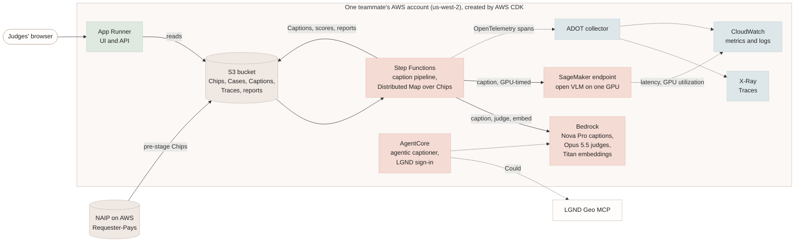
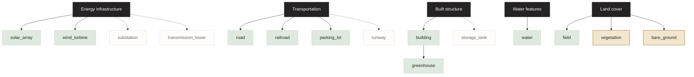
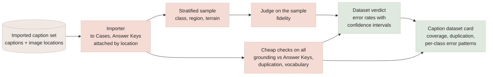

# Caption generation: design notes

**Status:** design only, nothing built yet (as of 2026-11-03). Written as a starting point to
elaborate in a later session.
**Vocabulary:** capitalized terms (Task, Case, Harness, Run, Trace, Judge, Rubric, Batch, Gate…)
are defined in [GLOSSARY.md](../GLOSSARY.md).

## 1. Sources and their state

- The authoritative requirements are in [tech-hackathon.md](tech-hackathon.md) (cited as
  *Technical*) and [vision-hackathon.md](vision-hackathon.md) (cited as *Vision*), text copies
  of `tech-hackathon.docx` and `vision-hackathon.docx`. They are **newer** than
  `Clay-Foundry-Technical-Hackathon.md` and `Clay-Foundry-Vision-Hackathon.md` and add most of
  the caption-track detail.
- Section 2 gives every requirement an ID: CAP-01 to CAP-19 (caption), AWS-01 to AWS-13 (AWS),
  and REQ-01 to REQ-19 (the evaluation loop as a whole).
- Facts marked *(from memory)* in sections 6–8 come from general knowledge of the field, not from
  the source documents, and should be re-checked before they go into a demo or the spec.

## 2. What the documents require

| Area | Requirement |
|---|---|
| Purpose | Training captions for the text-native Clay v2 model, and retrieval from text (e.g. "find railroads") |
| Inputs | NAIP high-resolution imagery (us-west-2, Requester-Pays); sample Vantor data (`s3://vantor-opendata`); LGND embeddings (https://source.coop/clay/lgnd-embeddings); optional auxiliary caption datasets |
| Task types | **Fixed:** one image of a place at one date. **Change:** two images of the same place at different dates; the caption describes what changed |
| What every caption must get right | **Position** (where objects are), **counts** (how many), **relationality** (how they sit relative to each other, e.g. "a road between two fields"), or for Change, changes in all three |
| Rubric | Five criteria. **Weights are not set yet: score and report each separately**, apply weights later |
| Answer keys | Global Renewables Watch v1.0 (solar and wind worldwide, MIT); USGS USPVDB / USWTDB (US solar and wind, public domain); OpenStreetMap (ODbL) |
| ADB's suggestion | Build on one region of GRW or USGS USPVDB/USWTDB, then test on another region that already has an LGND collection, using GRW, USGS, or OSM there as the answer key |
| VLM comparison | Run the same images and prompt through **more than one VLM**; compare cost in **GPU time and GPU count/size**, not tokens (a Should Have) |
| Tools | LGND Geo MCP server (commercial; teams are whitelisted for the hackathon, https://lgnd.ai/geo); RODA MCP server |
| Auxiliary datasets | Change: LEVIR-CC, Change-Agent (adds change masks), SECOND-CC, RSCC (larger; only a small subset may be human-labeled). Fixed: VRSBench, RSICD_optimal. Also listed: SkyScript, MegaEarth (Sentinel-2 + OSM labels, 485 classes). **Check each license; score only against human-labeled subsets** |
| Constraints | Public or synthetic data only. No SageMaker HyperPod or large Trainium clusters ("modest instance / managed endpoint" is fine). Training Clay v2 itself is out of scope |

### The five rubric criteria

| Criterion | What it checks | How the documents say to measure it |
|---|---|---|
| **Retrieval quality** | A caption can be found from a text query alone, with no image | Embed captions and queries with any off-the-shelf text model; record how often the right caption is in the top results |
| **Grounding** (most important) | The caption matches what's on the ground: objects, attributes, counts | Compare caption claims with reference labels (GRW, USGS, OSM, Vantor vectors, or human-labeled datasets) |
| **Fidelity** | The caption represents the image accurately overall | An LLM judge compares caption and image and gives a score |
| **Cost** | Throughput and time to output across VLMs | Same images and prompt for each VLM; record GPU time and number or size of GPUs |
| **Label preparation time** | How long labels take to prepare | Record the time taken to prepare each label set |

### 2.1 Requirement IDs

Every caption-specific requirement in the two source documents, with an ID the plan traces
([caption-plan.md §11](caption-plan.md#11-traceability)). Requirements for the evaluation loop as a
whole (MCP, Traces, summaries, Workflow Score, replay, swappability, provenance, license) are
REQ-01 to REQ-19 in [section 2.3](#23-evaluation-loop-requirements) and apply to caption Runs
unchanged.

| ID | Requirement | Sources |
|---|---|---|
| CAP-01 | Fixed task: one image, one date; the caption gets position, counts, and relationality right | *Technical* §Task types; *Vision* §Caption Generation: Task types |
| CAP-02 | Change task: two dates of one place; the caption describes changes in position, counts, and relationality | *Technical* §Task types; *Vision* §Caption Generation: Task types |
| CAP-03 | Input: NAIP high-resolution imagery | *Technical* §The Tasks, §Confirmed Data Sources; *Vision* §The Three Tasks |
| CAP-04 | Input: sample Vantor data (`s3://vantor-opendata`) | *Technical* §The Tasks; *Vision* §The Three Tasks, §External Dependencies |
| CAP-05 | Output: training captions for the text-native Clay v2 | *Technical* §The Tasks; *Vision* §Business Drivers, §The Three Tasks |
| CAP-06 | Captions enable retrieval from text, e.g. "find railroads" | *Technical* §The Tasks; *Vision* §The Three Tasks |
| CAP-07 | Captions are scored against Clay's example captions | *Technical* §The Tasks, §Observability "Output"; *Vision* §The Three Tasks, §External Dependencies |
| CAP-08 | Captions are scored against Clay's retrieval evaluation datasets | *Technical* §The Tasks, §Observability "Output"; *Vision* §The Three Tasks, §External Dependencies |
| CAP-09 | Retrieval quality: text query only, any off-the-shelf text embedding model, right caption in the top results | *Technical* §Rubric, §Preferred Libraries; *Vision* §Rubric |
| CAP-10 | Grounding (most important): objects, attributes, and counts compared with reference labels (GRW, USGS, OSM, Vantor vectors, or human-labeled data) | *Technical* §Rubric; *Vision* §Rubric |
| CAP-11 | Fidelity: an LLM judge rates the caption against the image | *Technical* §Rubric; *Vision* §Rubric |
| CAP-12 | Cost: same images and prompt across more than one VLM; GPU time and GPU count and size, not tokens | *Technical* §Rubric, §Models, §Observability "Capture"; *Vision* §Rubric, §Features In Scope (Should) |
| CAP-13 | Label preparation time: record the time to prepare each label set | *Technical* §Rubric; *Vision* §Rubric |
| CAP-14 | The caption task is scored on all five criteria | *Vision* §MVP Success Criteria 4 |
| CAP-15 | Each criterion is reported on its own until Clay sets weights | *Technical* §Rubric; *Vision* §Rubric, §Key Risks |
| CAP-16 | Develop on one region of GRW or USGS; test on another region with an LGND collection, using GRW, USGS, or OSM as the answer key | *Technical* §Retrieval answer key; *Vision* §Retrieval answer key |
| CAP-17 | Auxiliary caption datasets: check each license; score only against human-labeled data | *Technical* §Auxiliary Caption Datasets; *Vision* §Key Risks, §External Dependencies |
| CAP-18 | Clay/LGND embeddings are used for the caption or retrieval task | *Technical* §Models, §Preferred Libraries; *Vision* §Business Drivers |
| CAP-19 | NAIP is Requester-Pays in us-west-2: read via MCP or pre-stage a small sample | *Technical* §Cloud Provider, §Preferred Technologies; *Vision* §Key Risks |
| CAP-20 | Caption sets from any source can be scored: an imported set of captions with image locations (or images) becomes Cases, with Answer Keys attached by location, scored on the same criteria with no Harness run | *Vision* §Business Drivers ("Clay v2 depends on caption data nobody has tested … Clay has no bandwidth to evaluate those caption workflows"); *Vision* §Target Users ("Clay model & data team … without hand-checking every run") |
| CAP-21 | A caption set gets a dataset-level verdict: a stratified sample (by class, region, terrain), error rates with confidence intervals, and the cheap deterministic checks run on far more captions than the Judge | *Vision* §Business Drivers ("Clay v2 depends on caption data nobody has tested … Clay has no bandwidth to evaluate those caption workflows") |
| CAP-22 | A caption set gets a dataset card: duplication, class and region coverage, vocabulary spread, and per-class error patterns using the Object Ontology | *Vision* §Business Drivers ("Clay v2 depends on caption data nobody has tested … Clay has no bandwidth to evaluate those caption workflows"); *Vision* §Business Constraints (trust and provenance) |

### 2.2 AWS integration requirements

The hackathon judges **technological implementation: technical execution and integration of
appropriate AWS services** (judging criteria, shared by the organizers). These requirements say
which AWS services the caption capability uses and why; each one maps to a rubric criterion or a
constraint in the briefs, so no service is there for show. Plan status is traced in
[caption-plan.md §11](caption-plan.md#aws-integration-requirements).

Context from the briefs: Clay already uses S3, SageMaker, Bedrock, and Snowflake; the model must
sit behind an abstraction on Bedrock; a "modest instance / managed endpoint" is allowed for
inference; HyperPod, large Trainium clusters, multi-account deployment, and a full
warehouse are not (*Technical* §Customer Team Experience, §Models, §Service Disallow List). Each
teammate has their own hackathon AWS account in us-west-2.

| ID | Requirement | Service | Serves | Sources |
|---|---|---|---|---|
| AWS-01 | Captioning VLMs and the Judge are called through Bedrock behind one model interface | Amazon Bedrock (Nova Pro, Claude Opus 5.5) | CAP-11, REQ-10, REQ-19 | *Technical* §Models; judging criteria |
| AWS-02 | Retrieval embeds Captions and queries with a managed text embedding model | Bedrock: Titan Text Embeddings v2 | CAP-09 | *Technical* §Preferred Libraries ("off-the-shelf text embedding model") |
| AWS-03 | Chips, Cases, Captions, Traces, reports, and Batches live in a private, encrypted bucket per account | Amazon S3 | CAP-19, REQ-14 | *Technical* §Cloud Environment; *Vision* §Business Constraints (provenance) |
| AWS-04 | At least one open VLM is served from a managed GPU endpoint, so cost can be measured in GPU time and GPU type and count | Amazon SageMaker real-time endpoint, one GPU instance | CAP-12, CAP-14 | *Technical* §Models ("Caption VLMs"), §Service Disallow List ("managed endpoint") |
| AWS-05 | Traces are exported to AWS's own observability, with faults and Soft Failures visible as errors | AWS Distro for OpenTelemetry → AWS X-Ray and Amazon CloudWatch | REQ-04, REQ-11 | *Technical* §Observability; *Vision* §Core Concepts ("observability sandbox") |
| AWS-06 | Per-Run measurements are published as metrics: time to output, GPU-seconds, tokens, Harness Faults | Amazon CloudWatch metrics | CAP-12, REQ-04 | *Technical* §Observability "Capture" |
| AWS-07 | One infrastructure-as-code app creates the whole stack in any teammate's account | AWS CDK (CloudFormation) | REQ-16; technical execution | *Technical* §Hackathon Approach ("migration-aware"); judging criteria |
| AWS-08 | The UI and API run as a hosted service with a URL the judges can open | AWS App Runner (or ECS Fargate) from the existing container image | REQ-12; design | *Vision* §Features In Scope ("Minimal UI"); judging criteria |
| AWS-09 | The caption pipeline (Chips → Captions → scores → report) runs as a managed workflow with parallel fan-out over Chips | AWS Step Functions (Distributed Map) | REQ-08; technical execution | judging criteria |
| AWS-10 | Large caption runs, once the prompt is settled, use batch inference | Bedrock batch inference | CAP-12 (throughput) | *Technical* §Models |
| AWS-11 | The agentic captioner can run as a managed agent that holds the LGND sign-in and reaches MCP tools | Amazon Bedrock AgentCore (Runtime, Gateway, Identity, Observability) | REQ-02 (LGND), agentic captioning | judging criteria; *Technical* §Confirmed Data Sources (LGND Geo MCP) |
| AWS-12 | No disallowed services: no HyperPod or large Trainium, no cross-account deployment, no warehouse (Traces stay files in S3) | — | REQ-17 | *Technical* §Service Disallow List |
| AWS-13 | Access is least-privilege and short-lived: no credentials in the repo, a role per service, public access blocked on every bucket | AWS IAM | REQ-13, REQ-15 | judging criteria (technical execution); public repo |

Facts about newer services (AgentCore's components, App Runner regions, SageMaker GPU instance
types and default quotas) are from general knowledge and must be checked in an account before
they're relied on.

### 2.3 Evaluation-loop requirements

Requirements on the evaluation loop as a whole, from the Vision MVP scope and the Technical
observability and constraint sections. They apply to caption Runs as written; plan status, and
what caption Runs need for each, are traced in
[caption-plan.md §11](caption-plan.md#11-traceability).

| ID | Requirement | Sources |
|---|---|---|
| REQ-01 | A Harness performs a Case from prompt to final answer, every tool call through an MCP server, its model on Bedrock behind an abstraction; a Run that errors or exhausts its step budget still ends with a recorded status | *Vision* §MVP Success Criteria, §Features In Scope ("LLM harness over MCP tools"), §MVP Definition of Done |
| REQ-02 | MCP servers under test are pinned; more can be added by configuration and attached to one Run; the servers the Task needs from Clay's shortlist are configured | *Technical* §Models and AI Services; *Vision* §External Dependencies |
| REQ-03 | Synthetic Cases for the ADB Task. ADB only: Clayzer doesn't take on that Task; caption Cases are CAP-01 to CAP-04 and CAP-16 | *Technical* §The Tasks; *Vision* §The Three Tasks |
| REQ-04 | The Trace records every model turn and tool call in order, with inputs, outputs, and latency; failures (including Soft Failures) attributed as Harness or Environment Faults (ADR-0003); retries identifiable; cost as measured usage (tokens, or GPU time when self-hosted) with any dollar figure labeled an estimate; written as the Run progresses | *Technical* §Observability and Evaluation ("Capture"); *Vision* §Features In Scope ("Trace capture"), §MVP Success Criteria |
| REQ-05 | Each Run gets a plain-language summary from the Trace alone: what the Harness did, where it struggled and whose fault, and a one-line verdict; plus a per-Step view | *Technical* §Observability and Evaluation ("Summarize"); *Vision* §Features In Scope ("Trace summarization") |
| REQ-06 | A Workflow Score computed from the Trace alone, with no model call: tool-call correctness and sequencing against the Case, tool-call success, recovery after Harness Faults, steps and cost against the Case's budget; Environment Faults don't lower it; each component gives a reason, and components that don't apply are left out | *Technical* §Observability and Evaluation ("Workflow"); *Vision* §MVP Success Criteria, §Features In Scope ("Scoring against rubric/reference") |
| REQ-07 | An Output Score against a Rubric that is data, each criterion with a score and a reason; a Judge's evidence is the Trace (for captions, also the Chip); Judge variance controlled and reported (ADR-0005); the Rubric in use is the one Clay confirms | *Technical* §Observability and Evaluation ("Output"); *Vision* §MVP Success Criteria, §MVP Definition of Done, §Key Risks |
| REQ-08 | Each scored Run produces a human-readable report (summary, scores with reasons, Steps, final answer) and a machine-readable one, from any recorded Trace without running the Harness again | *Technical* §Observability and Evaluation ("Report"); *Vision* §Features In Scope ("Evaluation report") |
| REQ-09 | A recorded Trace can be scored and reported with no model, MCP server, credentials, or network (Judge verdicts replayed from saved results); curated Stories are ready if the live Harness fails | *Technical* §Hackathon Approach ("Reliability: record traces"); *Vision* §Features In Scope ("Recorded-trace replay"), §MVP Definition of Done |
| REQ-10 | Harness and Judge reach models through one abstraction, so changing models is configuration; a Story shows the same Case on two models with scores compared | *Technical* §Hackathon Approach, §Models and AI Services; *Vision* §Features In Scope ("Swappable tracing tool + model") |
| REQ-11 | Tracing backends plug in behind one interface and scoring never reads a backend's format (ADR-0001); an OpenTelemetry backend follows the GenAI conventions with failures and fault attribution visible; the REQ-10 Story is shown both ways | as REQ-10; *Technical* §Frameworks and Libraries |
| REQ-12 | A minimal, locally served browser view lists Runs and opens each Run's report, scores, summary, and Steps; launching a Run from it is off unless enabled; it exposes no files outside its configured directories | *Vision* §Features In Scope ("Minimal UI", Should); *Technical* §Programming Languages, §Preferred Libraries |
| REQ-13 | Public or synthetic data only; nothing in the shareable demo material identifies the machine, network, or organization it was recorded on | *Technical* §Hackathon Approach, §Service Disallow List; *Vision* §Business Constraints |
| REQ-14 | Every scored Run keeps its Trace, the Rubric's id, version, and content hash, a snapshot of the Case as scored, and the Judge model and sample count | *Vision* §Business Constraints |
| REQ-15 | Apache-2.0, committed to the open-source repo created at kickoff; dependencies and MCP servers under test pinned by hash | *Vision* §Business Constraints, §MVP Definition of Done, §External Dependencies |
| REQ-16 | Runs in a single empty AWS account with no link to Clay's production; a readiness check before real Runs; portable (container image and setup guide); a small NAIP sample pre-staged to bound Requester-Pays cost | *Technical* §Cloud Environment, §Hackathon Approach; *Vision* §Key Risks |
| REQ-17 | No HyperPod or Trainium clusters, no multi- or cross-account deployment, no full warehouse; Traces are lightweight files | *Technical* §Service Disallow List |
| REQ-18 | Python 3.12+; the MCP SDK, boto3, and an OpenTelemetry-based tracing option; a thin web UI behind FastAPI | *Technical* §Programming Languages, §Frameworks and Libraries |
| REQ-19 | The Judge SHOULD use a different model from the Harness; when they're the same, every report says so and the readiness check warns | derived from *Vision* §Business Constraints ("Trust and provenance are first-class") |

## 3. Architecture

Clayzer is a self-contained Sandbox for the caption **Task**: its own Cases, Harness, Rubric,
Traces, Judge, reports, Batches, Compare, regression gate, provenance, and UI, all in this repo.

```
answer keys (USGS / GRW / OSM) ──► Case builder ──► Cases: chip location, date(s), reference labels
                                                       │
NAIP chips ──────────────────────► Caption Harness ◄───┘  (a VLM; swappable: Bedrock VLMs,
                                   │  structured caption:      self-hosted open VLMs on a GPU)
                                   │  text + objects/counts/positions/relations
                                   ▼
                                 Trace  (+ GPU time, GPU type/count for self-hosted VLMs)
                                   ▼
             ┌─────────────┬─────────────┬─────────────┬──────────┬────────────────┐
         Retrieval     Grounding      Fidelity        Cost      Label prep time
        (text embed,  (claims vs     (VLM Judge:   (GPU-sec,   (wall time per
         recall@k)    answer key)    image+caption) captions/h)  label set)
             └─────────────┴──────── five separate scores ───────┴────────────────┘
                                   ▼
                    report · Batch per VLM · Compare · gate
```

### 3.1 Cases, built from answer keys

- Start with **solar and wind**. USGS USPVDB and USWTDB give exact locations, sizes, and turbine
  counts, so a chip containing an array or turbines comes with a reference answer: what is
  there, and how many.
- Add OSM features (roads, water, buildings) so **relationality** can be checked ("a solar array
  south of a road"), plus **negative chips** with no target.
- **Change Cases almost build themselves.** USGS records each site's installation year. A site
  built between two NAIP flights (NAIP revisits a state every 2–3 years) gives a natural "before:
  empty field / after: solar array" pair.
- **Region split, following ADB:** a development region for tuning prompts, and a held-out test
  region that has an LGND collection, scored once. This doubles as the held-out Case set the
  improvement loop needs.
- A caption Case (`src/clayzer/cases.py`) holds: chip bounding box, date or date pair, task type
  (fixed/change), and reference labels (object type → count, position, relations).

### 3.2 Caption Harness

- A VLM gets the chip(s) and returns a **structured caption**: free text (for retrieval and Clay
  v2 training) plus a list of **claims** (object type, count, position, relations) that grounding
  can check mechanically.
- **Two kinds of VLM:**
  - **Bedrock VLMs** (Claude, Nova). Called through the Converse API with the Chip as an image
    block (`src/clayzer/harness.py`). They report tokens and latency only.
  - **Open VLMs on a GPU instance.** The only way to measure the **GPU time** the rubric asks for.
    A modest GPU instance or a managed endpoint is allowed. Needs AWS work, which is on hold.
- **Agentic version (later):** the Harness uses the LGND Geo MCP server and RODA to find and fetch
  imagery, so the Workflow Score applies to captioning too.

### 3.3 Scoring the five criteria

Captions **report the five criteria separately**, with no weighted overall until Clay sets
weights (CAP-15; ADR-0004 applies once they do).

| Criterion | Proposed implementation |
|---|---|
| Retrieval | Embed every test-region caption and a query set ("find solar farms", "find wind turbines", "find railroads"…) with an off-the-shelf text embedding model; recall@k and MRR, with the answer key defining which chips are correct per query |
| Grounding | Deterministic: per-claim comparison with reference labels: count error, presence precision/recall, position agreement (e.g. by image quadrant), relation agreement |
| Fidelity | An image-aware Judge that sees the image and the caption; judge sampling (ADR-0005) and Calibration Labels to measure how far it can be trusted. Also gives a visual check for Unsupported Claims |
| Cost | Per Step: GPU-seconds, GPU type and count, captions per GPU-hour, time to first output. Bedrock VLMs: tokens and latency only, marked as not comparable |
| Label prep time | Wall time per label set; **meaning is ambiguous**, see section 5 |

### 3.4 AWS services

How AWS-01 to AWS-13 fit together. Everything is created by one CDK app (AWS-07) in a teammate's
own account; nothing spans accounts.



| Service | Role | Why this one |
|---|---|---|
| Bedrock (AWS-01, AWS-02, AWS-10) | Captioning VLMs, the Judge, Titan embeddings, batch captioning | Already behind Clayzer's one Bedrock client (`src/clayzer/config.py`); Nova Pro and Claude are reachable today |
| S3 (AWS-03) | The one store; every scored Run keeps its inputs and evidence | Provenance constraint; Requester-Pays NAIP staged once per account |
| SageMaker endpoint (AWS-04) | Hosts open VLMs on one GPU instance | The only way to measure GPU-seconds: Bedrock doesn't expose GPU time. GPU-seconds per Caption = endpoint model latency × the instance's GPU count, labeled with the GPU type |
| ADOT → X-Ray and CloudWatch (AWS-05, AWS-06) | Traces and metrics in AWS's consoles | The Trace stays the record (ADR-0001); this adds an OpenTelemetry export, with fault and Soft Failure attributes, that lands in AWS's consoles |
| CDK (AWS-07) | Creates bucket, roles, endpoint, collector, pipeline, and service | Each teammate has a separate account; one app gives everyone the same stack |
| App Runner (AWS-08) | Hosts the UI and API container | The image already builds; a live URL for the judges |
| Step Functions (AWS-09) | Runs the caption pipeline with parallel fan-out | The pipeline is visible as a workflow, and retries and failures are per Chip |
| AgentCore (AWS-11) | Hosts the agentic captioner and holds the LGND OAuth sign-in | LGND's MCP server is remote and needs OAuth, which a laptop MCP client handles poorly |

Order of value against effort: AWS-04 and AWS-05 first (each closes a rubric gap), then AWS-07
and AWS-08 (a reproducible stack and a live URL), then AWS-09, AWS-10, and AWS-11.

### 3.5 Object Ontology

Every Object Class a Claim can name is defined once, in
[`ontology/objects.toml`](../ontology/objects.toml)
([ADR-0008](adr/0008-object-classes-live-in-one-ontology-file.md)). Version 0.1 has the 11
claimable classes the code uses today under five roots (energy infrastructure, transportation,
built structures, water features, land cover), plus candidate classes for later (substation,
transmission tower, runway, storage tank).



Green classes have an Answer Key; amber classes are claimable but unscored (no Answer Key);
dashed classes are candidates, not yet claimable.

| What each class records | Used for | Criterion |
|---|---|---|
| Parent class (is-a) | Partial credit when a Claim names a parent or sibling of the Reference Label's class (`distance`) | Grounding (CAP-10) |
| Answer Keys and OSM tag rules | Building Reference Labels; reporting which Claims no Answer Key covers | Grounding, label prep time (CAP-10, CAP-13) |
| Synonyms | Expanding retrieval queries and Captions onto shared terms ("solar farm", "PV plant") | Retrieval (CAP-09, CAP-06) |
| Look-alikes (`confusers`) | Warnings in the prompt; choosing negative Cases (greenhouses and parking lots vs solar arrays) | Fidelity, grounding |
| Minimum visible size at 0.6 m | Stopping Claims about things NAIP can't show | Fidelity |
| Attributes | The values a Claim may carry (`size`, `surface`) | Grounding |
| RSICD scenes, NLCD and WorldCover classes | Comparing scores across our Cases and outside benchmarks; scene-level only, never grounding | Fidelity, retrieval |

**Today vs planned.** The file matches the code's existing lists exactly, and
`tests/test_ontology.py` keeps them matched. Still to do: have the code read its lists from the
file, add partial credit to grounding, expand retrieval with synonyms, and put look-alikes in the
prompt (plan §7). Land-cover crosswalks come from general knowledge and need checking against the
published NLCD and WorldCover legends.

### 3.6 Evaluating caption data from any source

The business driver is that **Clay v2 is trained on synthetic captions nobody has tested, and
Clay has no bandwidth to evaluate them**. So the Sandbox must score *Clay's* caption data, not
only Captions our own Harness writes (CAP-20 to CAP-22). The pitch in one sentence: *give us your
caption set, and we tell you how much of it you can trust, where it fails, and what it costs to
make better.*



| Part | Design | Requirement |
|---|---|---|
| **Importer** | Reads a caption set in a documented format: one record per caption with its text, an image id, and either an image or a location (bounding box and date). Each record becomes a Case; Answer Keys attach by location exactly as for our own Chips (ADR-0006 still applies: the source of the captions never sees them). Captions without structured Claims are scored on text: Claims are extracted from the text by a model before grounding, and that extraction is itself recorded and calibrated | CAP-20 |
| **Stratified sampling** | Strata from the Object Ontology's classes, the region, and terrain; enough items per stratum for an interval of useful width (e.g. ±10 points at 95% for a rate near 50% needs about 100 items) | CAP-21 |
| **Cheap checks at scale** | Grounding against Answer Keys, duplication, vocabulary statistics, and Claims about classes NAIP can't show (minimum visible size) need no Judge, so they run on the whole set or a much larger sample than fidelity does | CAP-21 |
| **Confidence intervals** | Every rate in the verdict is reported with a 95% interval (Wilson for proportions), and per stratum, so a reader can see where the estimate is thin | CAP-21 |
| **Caption dataset card** | One report per caption set: size and duplication rate; class, region, and terrain coverage against what Clay will caption; vocabulary spread; and per-class error patterns from the ontology (miscounts, look-alike confusions such as greenhouses called solar arrays) | CAP-22 |

**What this can't show.** Whether captions *improve Clay v2* can only be shown by training it,
which is out of scope. Retrieval with an off-the-shelf text model is a proxy for that, and the
card says so.

#### Assumed import format (to confirm with Clay)

Clay hasn't shared its caption data yet, so the importer is built against an **assumed format**
that mirrors what Clay already publishes: its LGND embeddings on Source Cooperative are
GeoParquet, one row per chip with a footprint geometry, partitioned by geohash and date, with
catalogs of the source scenes. A Caption Set from the same team would most plausibly look the
same.

**A Caption Set is GeoParquet (JSON Lines also accepted for small sets), one row per caption:**

| Column | Type | Required | Meaning |
|---|---|---|---|
| `caption_id` | string | yes | Unique per caption |
| `chip_id` | string | yes | The image the caption describes; several captions may share one |
| `caption` | string | yes | The caption text |
| `kind` | `fixed` or `change` | yes | One date or two |
| `geometry` | polygon, EPSG:4326 | yes | The chip's footprint (WKB in GeoParquet, GeoJSON in JSON Lines) |
| `datetime` | ISO date, or a list of two for `change` | yes | Acquisition date or dates |
| `sensor` | string, e.g. `naip`, `sentinel-2-l2a` | yes | Which imagery the caption describes |
| `gsd_m` | number | yes | Ground sample distance, metres per pixel |
| `stac_item` | string | no | Source scene (STAC collection and item id), used to fetch the image |
| `image_uri` | string | no | A direct link to the chip image, if there is one |
| `generator` | string | no | The model or pipeline that wrote the caption, with its version |
| `claims` | JSON | no | Structured Claims in the ADR-0007 format, if the source has them |

One row in JSON Lines:

```json
{"caption_id": "c-000123", "chip_id": "s2-9q5c-2023-06", "caption": "Rows of solar panels cover the centre of the tile, with a highway along its northern edge.", "kind": "fixed", "geometry": {"type": "Polygon", "coordinates": [[[-118.04, 35.18], [-118.03, 35.18], [-118.03, 35.19], [-118.04, 35.19], [-118.04, 35.18]]]}, "datetime": "2023-06-14", "sensor": "sentinel-2-l2a", "gsd_m": 10, "stac_item": "sentinel-2-l2a/S2B_11SLU_20230614_0_L2A", "generator": "caption-pipeline v2.1"}
```

**How the importer uses it:**
- `geometry` and `datetime` attach Answer Keys by location and date, exactly as for our own
  Chips. A Reference Label only counts if the site existed by the acquisition date.
- **Captions may not be NAIP.** Clay's published embeddings are Sentinel-2 (10 m), so its
  captions may be too. The importer compares each Object Class's `min_visible_m` in the Object
  Ontology with the row's `gsd_m`, and flags Claims about objects too small for the imagery (a
  wind turbine at 10 m, for example). That's a useful check on synthetic captions in its own
  right, and the 3×3 position grid is applied to the chip's own footprint, whatever its size.
- `stac_item` or `image_uri` gives the Judge the image for fidelity. Rows with neither are
  scored on grounding and retrieval only, and the verdict says so.
- `claims` is used when present; otherwise Claims are extracted from `caption` by a model, as
  described above.
- `generator` lets one Caption Set mix pipelines and compare them, like Batches.

**If the real format differs,** only a small adapter changes: the importer maps any source onto
these columns, and everything downstream stays the same. Until Clay's data arrives, the importer
is built and tested on RSICD's Reference Captions (converted to this format) and on our own
Caption files.

## 4. Phases

| Phase | Delivers | Depends on |
|---|---|---|
| 0. Check the facts | Access to NAIP, GRW, USGS, `vantor-opendata`, LGND collections (and which regions have them); license of each auxiliary dataset; what Vantor's sample data contains | Mostly doable now |
| 1. Fixed-caption MVP | ~50 chips from one region; one Bedrock VLM; grounding and fidelity scores; reports and UI | Image content in the model interface |
| 2. Retrieval | Dev and test regions; query set; recall@k | Phase 1 |
| 3. VLM comparison | 2–3 open VLMs on one GPU instance plus Bedrock VLMs; GPU-time capture; a Batch per VLM; Compare and gate | A GPU instance (AWS, on hold) |
| 4. Change captions | Before/after pairs from USGS installation years | Phase 1 |
| 5. Agentic captioning | Harness uses the LGND MCP server; Workflow Score; label prep timing; demo Stories | LGND access |

## 5. Decisions and risks

1. **Don't grade captions with the data used to write them.** If the Harness sees OSM labels
   while captioning, grounding against OSM is circular. Answer keys must stay hidden from caption
   inputs; ADB's region split helps.
2. **Cost in GPU time means self-hosting.** Bedrock doesn't expose GPU time. Phases 1–2 can use
   Bedrock VLMs with the cost criterion marked partial.
3. **"Label preparation time" is ambiguous:** the time to build the reference labels (answer
   keys), or the time to produce captions, which are themselves training labels for Clay v2?
   Ask Clay.
4. **NAIP Requester-Pays cost:** pre-stage a small chip set once and reuse it across Batches.
   Chips should also go into the demo pack (NAIP is public domain) so caption Stories replay
   offline.
5. **Clay's example captions** are still needed to check caption style; until then, use the
   auxiliary datasets' human-labeled subsets.
6. **Rubric weights are unset:** never publish a single combined caption score until Clay sets
   them.

## 6. How VLMs produce captions *(from memory)*

```
image ──► vision encoder (a ViT, often CLIP-style) ──► projector ──► language model ──► caption, word by word
                                                               ▲
                                                    prompt: "Describe this image…"
```

The vision encoder turns the image into visual tokens; a small projector maps them into the
language model's input space; the language model writes the caption one token at a time.
Caption quality depends on the training data (image-text pairs, then instruction tuning), the
prompt ("one sentence" vs "list every object with counts and positions"), and decoding
(deterministic vs sampled; length).

**Why overhead imagery is hard for general VLMs:** they're trained mostly on ground-level
photos. From above they miscount (panel rows, cars, turbines), misjudge scale (pond or lake),
confuse look-alikes (greenhouses vs solar arrays), and write generic text ("an aerial view of a
rural area"). Remote-sensing VLMs and datasets exist to close that gap.

## 7. Known patterns for creating captions automatically *(from memory)*

| Pattern | How it works | Examples | Strength / weakness |
|---|---|---|---|
| Labels to text | Turn map labels (OSM tags, land-cover classes) into sentences by template or LLM | SkyScript; ChatEarthNet | Grounded by construction / only as rich as the labels; can be stilted |
| Teacher recaptioning | A strong VLM writes detailed captions; a smaller model is trained on them | ShareGPT4V; recaptioning of web datasets (as for DALL-E 3) | Rich text / inherits the teacher's errors and cost |
| Generate then filter | Generate several candidates; keep the one an image-text matching model scores highest | BLIP's CapFilt | Cheap quality boost / the filter has blind spots |
| Tools first, then words | Detectors/segmenters produce a structured scene; an LLM writes the caption from it plus the image | Scene-graph-to-text; "visual programming" | Counts and positions are measured / tool errors carry through |
| Region-level, then whole-image | Caption regions with locations, then combine | Dense and grounded captioning (e.g. Kosmos-2 location tokens) | Good for position and relations / more steps and cost |
| Change captioning | Encode both dates together, often with a change mask, and describe the difference | LEVIR-CC, Change-Agent, SECOND-CC | Purpose-built for two dates / generic VLMs do poorly here |

## 8. Novel ideas for this hackathon

Each idea is mapped to the rubric criterion it serves.

1. **Verify, then write** (Grounding, Fidelity). The VLM first produces claims ("3 turbines,
   north-east of the road"); each claim is checked with an independent tool (a detector, an OSM
   lookup, a search over Clay/LGND embeddings); the final caption is written only from verified
   claims, with the rest marked uncertain. This is the Unsupported Claims idea applied to
   images. **Catch:** verify with different sources from those used to score, or grounding is
   circular.
2. **Embeddings choose what to caption** (Label prep time, Cost). Cluster Clay/LGND embeddings
   and caption a diverse sample instead of thousands of near-identical fields; send only
   uncertain chips to an expensive VLM or a human.
3. **Embeddings find change** (Cost, Change task). Compare a place's embeddings across two dates
   to find where something changed, and only send those pairs to the change captioner; most
   pairs show no meaningful change.
4. **Write captions so they can be found** (Retrieval). Generate likely queries for a chip
   ("find solar farms near highways"), test whether the caption ranks highly for them, and
   rewrite it if not: the image-captioning version of doc2query.
5. **Teacher → student on the cost frontier** (Cost, Fidelity). A large VLM captions a seed set;
   a small open VLM is fine-tuned or prompted to match it. Plot every VLM on quality vs
   GPU-seconds per caption; the rubric explicitly asks for this comparison.
6. **Several VLMs, keep the consensus** (Grounding). Run 2–3 VLMs per chip and keep the claims
   most agree on; the generation-side version of the Judge's median-of-samples.
7. **Improve the captioner with the existing loop** (all criteria). Treat the caption prompt or
   pipeline as the Harness: Batches, the five scores, Compare, and keep a change only if the gate
   passes. This is the team's main differentiator: not just a captioner, but one shown to get
   measurably better, with the cost of each improvement visible.

**Recommended combination:** 1 + 2 + 7, plus 5 if a GPU instance is available. It attacks
grounding and label-preparation cost directly, and every step is measured by the same
evaluation loop.

## 9. Open questions for Clay

- What does "label preparation time" measure (section 5, item 3)?
- Format and location of the example captions; are they fixed, change, or both?
- Which regions have LGND collections, and how is the LGND Geo MCP server accessed?
- Which VLMs should be compared, and what GPU instance and budget are acceptable?
- What is in Vantor's sample data, and is it meant as caption input or as reference labels?
- When will rubric weights be set?

## 10. Pointers into the code

| Need | Where it lives |
|---|---|
| Chips and Answer Keys | `src/clayzer/chips.py`, `src/clayzer/answer_keys.py` |
| Object Ontology | `ontology/objects.toml`, `src/clayzer/ontology.py`, `tests/test_ontology.py` |
| Case definition | `src/clayzer/cases.py`; Cases in `data/cases/*.jsonl` |
| Caption Harness | `src/clayzer/harness.py` |
| Grounding, fidelity, retrieval | `src/clayzer/grounding.py`, `src/clayzer/judge.py`, `src/clayzer/retrieval.py` |
| Batches, Trace, and cost recording | `src/clayzer/batch.py` |
| Compare and the regression gate | `src/clayzer/gate.py`; Baselines in `baselines/` |
| Reports and provenance | `src/clayzer/report.py`, `src/clayzer/report_html.py` |
| Requirements | Section 2.1 (CAP), section 2.2 (AWS), section 2.3 (REQ) |
| Design decisions | [docs/adr/](adr/) (ADR-0001 Trace format and ADR-0005 judge sampling are the most relevant here) |
