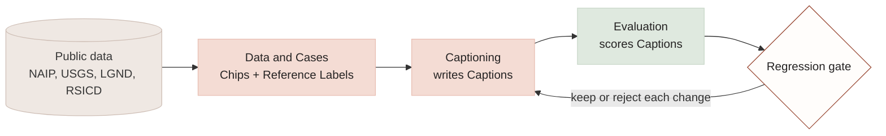
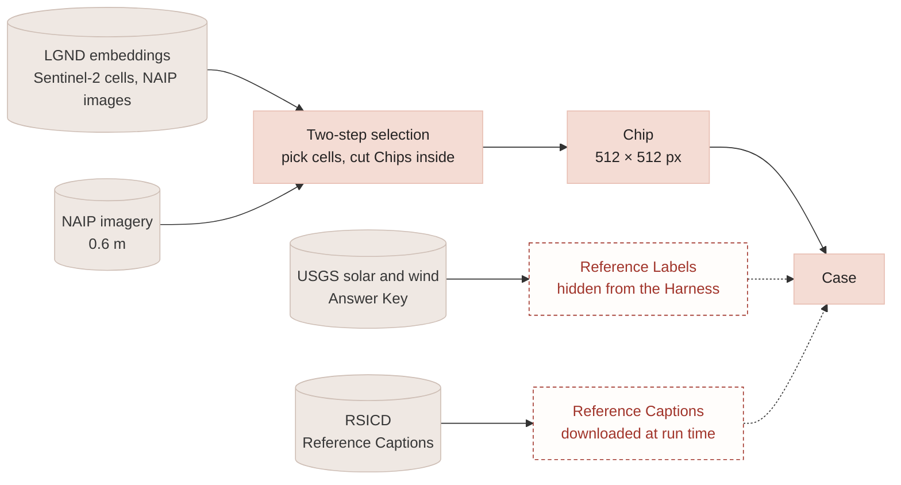
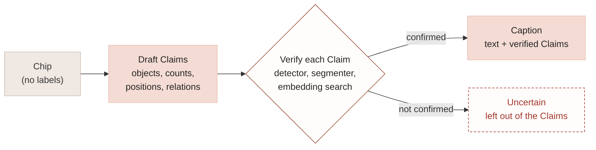
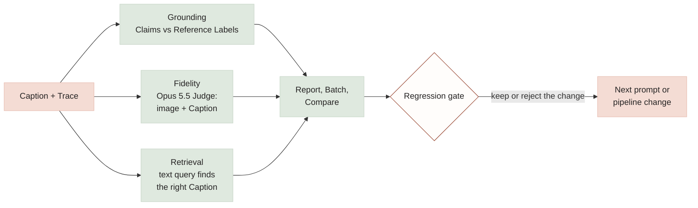
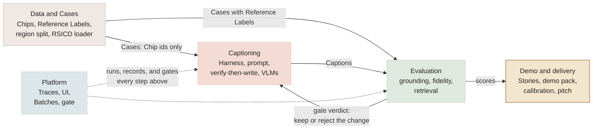
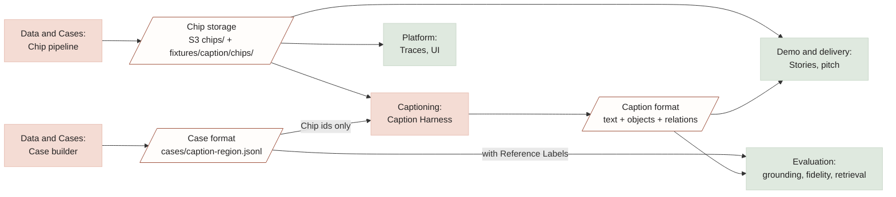
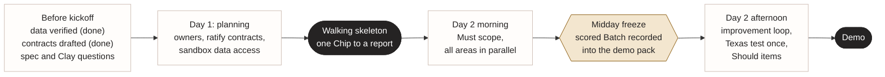

# Caption generation: hackathon plan

**For:** the whole team (six people).
**Status:** agreed plan, 2026-11-03. Owners are blank until Day 1.
**Read with:** [caption-design.md](caption-design.md) (the technical reference: requirements,
architecture, background), [GLOSSARY.md](../GLOSSARY.md) (every capitalized term here), and
the ADRs in [docs/adr/](adr/), especially
[0006](adr/0006-answer-keys-are-hidden-from-caption-inputs.md) and
[0007](adr/0007-claims-use-a-grid-and-a-fixed-relation-vocabulary.md).
**Source requirements:** [tech-hackathon.md](tech-hackathon.md) and
[vision-hackathon.md](vision-hackathon.md). Caption requirements are CAP-01 to CAP-19
([caption-design.md §2.1](caption-design.md#21-requirement-ids)); evaluation-loop requirements
are REQ-01 to REQ-19 ([caption-design.md §2.3](caption-design.md#23-evaluation-loop-requirements)). Section 11 traces each
one to this plan.

## 1. Goal

Build a caption-generation capability for the text-native Clay v2 model, and prove it with its own
evaluation loop: a Harness writes Captions for Chips of aerial imagery, and every
Caption is scored on the criteria Clay set: **grounding** (most important), **fidelity**, and
**retrieval**, then **cost** and **label preparation time** if time allows. The differentiator is
not just a captioner but one shown to get measurably better, with the cost of each improvement
visible, and an evaluator that scores **Clay's own caption data**, not only ours. Clay v2 is
trained on synthetic captions nobody has tested, and Clay has no bandwidth to test them
(*Vision* §Business Drivers): *give us your caption set, and we tell you how much of it you can
trust, where it fails, and what it costs to make better*
([caption-design.md §3.6](caption-design.md#36-evaluating-caption-data-from-any-source)).

### 1.1 The big picture



Data and Cases turns public data into Cases; Captioning writes a Caption for each; Evaluation
scores it; the gate decides whether each change to the captioner is kept. The next three diagrams
zoom into each part.

### 1.2 Where the data goes



A Case pairs a Chip with what it is graded against. The red, dashed boxes are reference data:
they travel with the Case to scoring but never reach the Harness
([ADR-0006](adr/0006-answer-keys-are-hidden-from-caption-inputs.md)). RSICD is never committed
to the repo.

### 1.3 How the Harness writes a Caption



Verify, then write: the Harness (Nova Pro) commits only to Claims an independent tool confirms.
The verifying tools must never be an Answer Key, or grounding becomes circular. Claims use the
3×3 grid and relation vocabulary of
[ADR-0007](adr/0007-claims-use-a-grid-and-a-fixed-relation-vocabulary.md).

The verifier is **LGND Geo's `reasoning_imagery_check`**, called over MCP (REQ-01). It takes a
Claim in plain words and the LGND images it's about, and an image model answers yes, no, or
maybe for each, with a reason. LGND's NAIP images are about 160 m across, roughly one 3×3 cell
of a Chip, so looking up the image at a cell's centre (`search_chip_lat_lon`) and checking "a
road" there tests a Claim's *position*, not just its presence. Land-cover Claims (`vegetation`,
`bare_ground`, `field`, `water`) can use LGND classifiers (`toolbox_classifier_build` and
`_apply`) instead. Tried on 2026-11-03: on Pine Tree Solar, "a large solar farm" came back
supported and "several wind turbines" not supported, both with sensible reasons.

Every verification is a Step in the Trace: the Sandbox summarizes it (REQ-05) and gives the Run
a Workflow Score (REQ-06): verification calls per Claim, failed calls, and steps against the
Case's budget. Our own caption MCP server is needed only for tools LGND lacks.

### 1.4 How a Caption is scored



Each criterion is reported on its own until Clay sets weights. Grounding uses the Case's Reference
Labels; fidelity and retrieval can also use RSICD's Reference Captions. Cost and label
preparation time join later (Should and Could).

## 2. Scope

| | Includes | Rubric criteria it serves |
|---|---|---|
| **Must** | Fixed Cases from USGS solar and wind sites, with NAIP Chips; ~60 Cases per region; **OSM Reference Labels for roads, buildings, water, and land use** in every Case, so most Claims are scored; the share of Claims no Answer Key covers, reported per Batch; Nova Pro captions, Opus 5.5 judges; grounding, fidelity, retrieval; ~100 RSICD test images as a human-caption benchmark for fidelity and retrieval; **verify-then-write over MCP, with LGND Geo's imagery check as the verifier**, so caption Runs get Trace summaries and a Workflow Score; **label preparation time** (wall-clock time to build each Case set and to caption it); **cost, partial**: time to output per Caption on Bedrock, marked partial because Bedrock hides GPU use; reports, Batches, gate, recorded-Trace replay, demo Stories; on AWS: Bedrock for captioning, judging, and Titan embeddings, a private S3 bucket per account, least-privilege IAM (AWS-01 to AWS-03, AWS-13); **score caption sets from any source**: an importer turns a caption set with image locations into Cases and scores them with no Harness run (CAP-20) | Grounding, Fidelity, Retrieval, Label prep time, Cost (partial) |
| **Should** | VLM comparison on GPU cost (2+ open VLMs on a GPU instance); Change Cases from USGS installation years and Global Renewables Watch construction dates; full RSICD test split (1,093 images); **VRSBench test split as a grounding benchmark** (human-checked object boxes give counts and 3×3 positions); **LEVIR-CC / LEVIR-MCI as a change benchmark** (human change captions plus building and road change masks); on AWS: a SageMaker GPU endpoint for open VLMs (AWS-04), Traces in X-Ray and run metrics in CloudWatch through ADOT (AWS-05, AWS-06), one CDK app for the stack (AWS-07), the UI on Fargate behind CloudFront (AWS-08); the code reads its object lists from the Object Ontology, with partial credit in grounding, synonym-expanded retrieval, and look-alikes in the prompt (ADR-0008); a dataset-level verdict with stratified sampling and confidence intervals (CAP-21); a caption dataset card with duplication, coverage, vocabulary, and per-class error patterns (CAP-22) | Cost, Grounding (fixed and change) |
| **Could** | Agentic captioning: the Harness also uses LGND Geo's search and classifiers to look beyond the Chip; Global Renewables Watch as an Answer Key outside the US; disaster Change Cases from Vantor (used under its own license, never committed); SECOND-CC (land-cover change maps); SkyScript's NAIP subset and MegaEarth for retrieval at scale; LGND embeddings as a second retrieval index (search Chips by embedding, compare with Caption-text retrieval); on AWS: the caption pipeline in Step Functions (AWS-09), Bedrock batch inference (AWS-10), AgentCore for the agentic captioner and its LGND sign-in (AWS-11); **stretch goals for cost and quality at scale** ([caption-design.md §8](caption-design.md#stretch-goals-cost-and-quality-at-scale), ideas 8–16): verified Claims per dollar, the cheapest resolution per class, escalation on low confidence, Claims-only output with prose written for free, open data first, Caption reuse across near-duplicates, Claims from embeddings, cheap evaluation at scale, cheaper hardware and calls | Grounding, Retrieval, Cost |
| **Out** | Training Clay v2; HyperPod or large Trainium clusters; a single combined caption score (rubric weights aren't set); cross-account deployment; a warehouse for Traces (AWS-12) | — |

Report each criterion separately until Clay sets weights.

## 3. Data

Access verified from a laptop on 2026-11-03 (small test reads only).

| Source | Role | Access | License |
|---|---|---|---|
| USGS USPVDB v4.0 (solar) | Answer Key: 6,611 sites with centroids, polygons, area, capacity, installation year. Only sites ≥1 MW DC; includes some rooftop, canopy, and floating arrays (system-type field), so filter to ground-mounted for Chips | Download from `energy.usgs.gov/uspvdb/data/` (the `eerscmap.usgs.gov` address in the brief can be blocked on some networks) | Public domain |
| USGS USWTDB v9.1 (wind) | Answer Key: 77,839 turbines with exact positions and installation years | `energy.usgs.gov/uswtdb/` (CSV 1.7 MB) | Public domain |
| NAIP on Planetary Computer | Chips during preparation: same imagery, free; 0.6 m, 2010–2023 | STAC search + short-lived SAS token, windowed COG reads | Public domain (USDA FSA) |
| NAIP on AWS (`naip-visualization`, `naip-analytic`) | Chips in the sandbox (verified 2026-11-03 from a participant account) | Requester-Pays, us-west-2; found through the Planetary Computer catalog, read with GDAL `/vsis3/` | Public domain |
| LGND embeddings (Source Cooperative) | Choosing what to caption (step 1 of two-step selection) | Anonymous; GeoParquet by geohash/month; query rows with DuckDB, don't download whole files (~340 MB each) | CC BY 4.0 |
| LGND Geo MCP server (`https://geo.lgnd.ai/mcp`) | Verifier for verify-then-write; choosing Cases. Embeddings of global Sentinel-2 (10 m, monthly, 2017 to April 2026) and contiguous-US NAIP (sub-metre, annual, 2020–2023), so Mojave/Tehachapi and Texas are covered | Commercial; whitelisted for the hackathon. OAuth sign-in per person; in Claude Code it loads from the repo's `.mcp.json` in a session started in the repo. 18 tools in four groups: search, discover, classify, check | LGND terms |
| RSICD (`201528014227051/RSICD_optimal` on GitHub; images from `arampacha/rsicd` on Hugging Face) | Reference Captions for fidelity and retrieval only | Captions and splits from GitHub; images from Hugging Face (same 8,734 / 1,094 / 1,093 split) | **None stated; imagery from commercial map services** |
| OpenStreetMap | Answer Key for everything that isn't solar or wind: roads, buildings, water, land use, rail, parking, greenhouses | Overpass or a regional extract, clipped to each Chip bbox | ODbL: committed Case files with OSM-derived labels need "© OpenStreetMap contributors" and stay under ODbL |
| Global Renewables Watch v1.0 | Should: construction date per site (estimated from quarterly imagery, Q4 2017–Q2 2024) for Change Cases. Could: Answer Key outside the US | GitHub release (wind 58 MB, solar 395 MB) | MIT |
| VRSBench | Should: grounding benchmark. Test split of 9,350 images with human-checked captions and 16,159 object references (boxes, 26 categories) | GitHub / Hugging Face; download at run time | Annotations CC BY 4.0 (the HF card also says CC BY-NC 4.0); DOTA images academic use only |
| LEVIR-CC / LEVIR-MCI | Should: change benchmark. 10,077 Chip Pairs (256 × 256, 0.5 m) from 20 Texas sites, with 50,385 human change captions plus building and road change masks | GitHub / Hugging Face; download at run time | HF card says Apache-2.0; Google Earth imagery academic use only |
| Vantor open data | Could: disaster Change Cases | Anonymous S3 listing; 12 disaster events from 2026, ~15 GB per scene | CC BY-NC 4.0 |

**Regions.** Develop and tune in **California's Mojave / Tehachapi area**; test once, at the end,
in **Texas**. Tuning never touches the Texas Cases.

**Cases per region.** About 40 positives (solar arrays and wind turbines, mixed sizes) and 20
negatives (farmland, towns, empty desert, and look-alikes such as greenhouses and parking lots).

**Chips.** 512 × 512 px at 0.6 m (about 300 m across), RGB.

**Two-step selection.** LGND embeddings are Sentinel-2 based (10 m pixels, 1,280 m cells), coarser
than a Chip. Use them to pick diverse or interesting cells, then cut NAIP Chips inside those cells.
LGND Geo also searches NAIP itself (`search_place_find` with text such as "solar farm" or
"greenhouse", or `like=` an example, inside a bounding box), so selection can work at Chip scale
too. That suits look-alike negatives: search for places that look like a solar farm, then keep
the ones USGS doesn't list.
Rules that keep every Chip verifiable:
- **Positives start from the Answer Key, not the cell.** Cut the Chip around a USGS site and
  compute the 3×3 position from its polygon or turbine point; LGND decides which sites to use
  (spread of sizes, terrain, surroundings). A cell that contains a site doesn't mean a Chip inside
  it does.
- **The NAIP date must be later than the site's installation year**, or the Reference Label is
  wrong.
- **Negatives need proven absence:** no USGS record inside the Chip bbox plus a buffer, then an
  eyeball check (USPVDB skips sites under 1 MW). LGND finds the look-alikes: cells whose embeddings
  sit near solar cells.
- **Include ordinary land.** Most of what Clay will caption is farmland and desert; a Case set made
  mostly of energy sites measures a rare case.

**What scores what.** Every Chip we cut has an Answer Key: USGS for solar and wind, OSM for
everything else. Outside benchmarks score the captioner on other people's images:

| Criterion | Our NAIP Cases | Outside benchmarks |
|---|---|---|
| Grounding, fixed | USGS + OSM Reference Labels | VRSBench object boxes (Should) |
| Grounding, change | USGS install years, GRW construction dates | LEVIR-MCI masks (Should); SECOND-CC maps (Could) |
| Fidelity | Opus 5.5 Judge on the image | RSICD, VRSBench, LEVIR-CC human captions |
| Retrieval | Queries from Answer Key classes | RSICD; SkyScript and MegaEarth at scale (Could) |

Not usable as gold: **RSCC** captions are all model-written (QvQ-Max), including its test set;
**SkyScript** captions are templated from OSM tags, so they show OSM coverage, not caption quality.
LGND embeddings and NAIP's near-infrared band are tools for choosing or verifying, never Answer
Keys.

**Storage.** Each teammate has their own hackathon AWS account, so there is no shared bucket:
**each account has its own S3 bucket, and git is the shared layer.** Everyone points
`CLAYZER_STORE` at their own bucket (`s3://clayzer-<account-id>-us-west-2/caption`); the code
reads and writes the same keys in any bucket (§5.3), or local folders when it's unset. The
shared Case set and about **50 development Chips are committed to the repo** for the demo pack
and tests (NAIP is public domain), and each teammate loads them into their bucket with
`clayzer push --from fixtures/caption`. Accepted Baselines and demo Runs are committed too; the
demo runs from the presenter's account. A cross-account team bucket would need only a new
`CLAYZER_STORE`, if the participant roles allow it.
Committed Case files carry OSM-derived Reference Labels, so they live in their own directory with
an ODbL notice; the rest of the repo stays Apache-2.0 (REQ-15).

**Provenance** (REQ-14). Benchmark Reference Captions are downloaded at run time, so each Run
records the dataset version or commit hash and the image ids it used, enough to fetch the same
references again. Every Batch also records what it was judged with (`src/clayzer/provenance.py`):
the caption prompt, the Judge's rubric, the frozen Cases, a SHA-256 of every Chip (checked
before each Run), the ontology's version, and the git commit. The Batch page shows them beside
the Baseline's, with a link to every stored file.

**Outside benchmark rules** (RSICD, VRSBench, LEVIR-CC / LEVIR-MCI). Their imagery is commercial
or academic-only, so the RSICD rules below apply to all of them. LEVIR covers Texas, our test
state; use it as a benchmark only and never tune on it.

**RSICD rules.**
- Download at run time; **never commit RSICD images or Reference Captions** to the repo.
- Demo Stories store only our Captions, scores, and RSICD image ids.
- Cite Lu et al. 2017, *Exploring Models and Data for Remote Sensing Image Caption Generation*,
  IEEE TGRS 56(4).
- Two-thirds of RSICD's captions are repeats; de-duplicate per image before using them as
  retrieval queries.
- Its captions rarely state counts or positions, so don't use them as a style to imitate.

**Answer Keys are hidden from caption inputs** ([ADR-0006](adr/0006-answer-keys-are-hidden-from-caption-inputs.md)).
No tool the caption Harness can call may read USGS, GRW, or OSM data for the region being scored.
The Evaluation owner checks the Harness's tool list against this table before each Batch:

| MCP server | Caption Harness | Case builder | Why |
|---|---|---|---|
| LGND Geo | Allowed | Allowed | Reads imagery embeddings and an image model, not OSM or USGS |
| stac-mcp, GeoLens, earthdata-mcp | Allowed | Allowed | Imagery catalogs; no Answer Key data |
| RODA | Allowed | Allowed | Open-data registry discovery and sampling |
| gis-mcp | Allowed only on Harness detections | Allowed | Geometry operations; becomes circular if fed OSM |
| openstreetmap-mcp-server, mcp-nominatim | **Forbidden** | Allowed | Read OSM, an Answer Key (even place names) |
| Overture Maps MCP | **Forbidden** | Allowed | Its buildings layer is a candidate second Answer Key for building counts |
| Weather, air-quality, routing, desktop-GIS servers | Not used | Not used | Nothing in an aerial Caption needs them |

The reverse holds too: a tool the Harness uses to verify Claims (LGND Geo's imagery check) must
never be used to score them.

## 4. Functional areas

The work is organized by function. Each area has one owner who makes sure it lands; anyone can
work in any area, and one person can own more than one.



Solid arrows are hand-offs between areas; their formats are the contracts in section 5. Platform
(dashed) is what the other areas run on.

| Area | Covers | Owner |
|---|---|---|
| **Data and Cases** | Chips from NAIP; Reference Labels from USGS and OSM; two-step selection with LGND embeddings; the region split; pre-staging Chips in S3; the RSICD loader; on AWS: the S3 layout and Requester-Pays NAIP staging (AWS-03); the Object Ontology (`ontology/objects.toml`, ADR-0008); the caption-set importer and its documented format (CAP-20) | ________ |
| **Captioning** | The caption Harness and prompt; structured Caption output; verify-then-write with LGND Geo over MCP, including the Harness's own OAuth sign-in; the VLMs (Nova Pro, Opus 5.5, open VLMs later); on AWS: the SageMaker GPU endpoint (AWS-04), Bedrock batch inference (AWS-10), the AgentCore captioner (AWS-11) | ________ |
| **Evaluation** | Grounding (objects, counts, positions, attributes), the image-aware Judge for fidelity, retrieval, label preparation time, cost (partial on Bedrock); the Workflow Score's caption expectations; on AWS: CloudWatch metrics for time to output, GPU-seconds, tokens, and Harness Faults (AWS-06); stratified sampling and confidence intervals (CAP-21); the caption dataset card (CAP-22) | ________ |
| **Platform** | Trace fields (including GPU time); UI views; Batches, Compare, and the gate for the caption Task; on AWS: the CDK app (AWS-07), Fargate hosting (AWS-08), the ADOT export to X-Ray and CloudWatch (AWS-05), the Step Functions pipeline (AWS-09), IAM roles (AWS-13) | ________ |
| **Demo and delivery** | Caption Stories and the demo pack; calibration labels; the pitch; readiness | ________ |

## 5. Contracts between the functions



These are **drafts** to ratify on Day 1. Once agreed, each functional area can build against them
without waiting for the others.

### 5.1 Case format

One JSON object per line in `cases/caption-<region>.jsonl`:

```json
{
  "id": "fixed-dev-uspvdb-58123",
  "task": "caption",
  "kind": "fixed",
  "region": "dev",
  "chips": [
    {"id": "ca-uspvdb-58123-20220618", "uri": "chips/ca-uspvdb-58123-20220618.png",
     "date": "2022-06-18", "bbox": [-118.033, 35.184, -118.027, 35.190], "source": "naip-pc"}
  ],
  "reference_labels": [
    {"object": "solar_array", "count": 1, "position": "centre", "attributes": {"size": "large"},
     "source": "uspvdb", "source_id": "58123"},
    {"object": "road", "count": 1, "position": "north", "attributes": {"surface": "paved"},
     "source": "osm", "source_id": "way/123456789"}
  ]
}
```

- `kind` is `fixed` (one Chip) or `change` (a Chip Pair, two entries in `chips`).
- `reference_labels` is **never shown to the Harness** (ADR-0006); only scoring reads it.
- RSICD Cases use `"source": "rsicd"`, an RSICD image id instead of a `uri`, and
  `reference_captions` loaded at run time instead of being stored.
- Negative Cases have no `solar_array` or `wind_turbine` labels; they still carry OSM labels.
- `source` is `uspvdb`, `uswtdb`, `osm`, or (later) `grw`.

### 5.2 Caption format

What the Harness returns for each Case:

```json
{
  "case_id": "fixed-dev-uspvdb-58123",
  "text": "A large solar array fills the centre of the image, with a paved road running along its north side and open desert to the south.",
  "objects": [
    {"id": "o1", "object": "solar_array", "count": 1, "position": "centre", "attributes": {"size": "large"}},
    {"id": "o2", "object": "road", "count": 1, "position": "north", "attributes": {"surface": "paved"}}
  ],
  "relations": [
    {"subject": "o2", "relation": "north_of", "object": "o1"}
  ],
  "uncertain": ["whether the structure in the south-east is a substation"]
}
```

- **Positions** ([ADR-0007](adr/0007-claims-use-a-grid-and-a-fixed-relation-vocabulary.md)):
  `north_west`, `north`, `north_east`, `west`, `centre`, `east`, `south_west`, `south`,
  `south_east`.
- **Relations:** `north_of`, `south_of`, `east_of`, `west_of`, `adjacent_to`, `between`, `inside`.
- **Objects:** the claimable classes of the Object Ontology,
  [`ontology/objects.toml`](../ontology/objects.toml)
  ([ADR-0008](adr/0008-object-classes-live-in-one-ontology-file.md)): `solar_array`,
  `wind_turbine`, `road`, `railroad`, `building`, `water`, `field`, `parking_lot`, `greenhouse`,
  `vegetation`, `bare_ground`. The file records each class's parent, Answer Keys and OSM tags,
  synonyms, look-alikes, and minimum visible size; extend it on Day 1 rather than editing lists
  in code.
- **Attributes (draft):** only those an Answer Key can check: `size` (`small`, `medium`,
  `large`, from USPVDB area) for solar arrays, `surface` (`paved`, `unpaved`, from OSM) for roads.
  Grounding scores attributes as well as objects and counts (CAP-10).
- `uncertain` holds what the Harness chose not to assert; it isn't scored as a Claim.
- For Change Cases, objects gain a `change` field: `appeared`, `disappeared`, or `unchanged`.

### 5.3 Chip storage

- Store layout, the same in every teammate's bucket and in the local `data/` and `runs/` folders:
  - `chips/<chip-id>.png` plus `chips/<chip-id>.json` (date, bbox, CRS, source, NAIP item id).
  - `cases/caption-<region>.jsonl`: Cases with Reference Labels. The Harness reads only
    `chips/`, never `cases/` (ADR-0006).
  - `runs/<run-id>/`: Trace, Captions, the Cases as scored, scores, `report.md`, `report.html`.
- A Chip's `uri` is its store key (`chips/<chip-id>.png`), not a full `s3://` URL, so Case files
  work in any teammate's bucket.
- `source` is `naip-aws` or `naip-pc`, whichever copy the pixels came from.
- Chip id: `<state>-<answer-key>-<source-id>-<yyyymmdd>`, or `<state>-neg-<n>-<yyyymmdd>` for
  negatives.
- The committed subset lives in `fixtures/caption/chips/` with the same names.

## 6. Approach

**Order of work** (decided 2026-11-03): the evaluation loop comes before caption quality. Build
Repeats, Batches, Compare, and the regression gate around the walking-skeleton Harness first, so
every later change to captioning is measured; only then build verify-then-write and iterate on
the prompt.

1. **Verify, then write.** The Harness first produces candidate Claims, checks each with an
   independent source over MCP (LGND Geo's imagery check, cell by cell; never an Answer Key),
   and writes the final Caption only from Claims that passed, putting the rest in `uncertain`.
2. **Embeddings choose what to caption.** Two-step selection (section 3) picks diverse,
   informative Chips instead of thousands of near-identical fields, with LGND Geo's NAIP search
   for look-alike negatives.
3. **Improve with the evaluation loop.** Each prompt or pipeline change is a new Batch; Compare
   shows the per-criterion effect; the regression gate decides whether to keep it.
4. **Teacher → student on the cost frontier** (Should, needs a GPU). A large VLM captions a seed
   set; a small open VLM is prompted or fine-tuned to match; plot quality against GPU-seconds per
   Caption.
5. **An agentic Harness** (Must; built 2026-11-04 with RODA, `clayzer batch --tools`). A tool-use loop in which the
   captioner calls geospatial tools over MCP before it writes: RODA and stac-mcp first, then
   LGND Geo (imagery check, classifiers). This is the briefs' first success criterion (REQ-01),
   and the tool calls are what the Workflow Score judges. Verify-then-write (1) is one use of it.
6. **Self-improvement** (Should; saved for later on 2026-11-04). A Proposer reads a failure
   digest of the latest Batch, proposes one change to the prompt, model, or tools with a
   hypothesis, runs a Batch, and keeps the change only if the regression gate passes; every
   attempt goes in an experiment ledger. The Texas test region is never shown to it.

**The core loop** is the brief's "heart of the build": **capture** every Step in a Trace (tool
calls, arguments, sequence, failures and retries, latency, cost), **summarize** each Trace,
**score** on two dimensions (Workflow Score from the Trace; Output Score on the five criteria),
and **report** per Run, with recorded Traces replayable through scoring. The web app's How it
works page walks through all ten steps, each with its tasks from `docs/tasks.toml`.

**Models.** Amazon Nova Pro writes Captions; Claude Opus 5.5 judges fidelity (an independent
Judge, since it didn't write them). Opus 5.5 also captions as the first comparison VLM; those
verdicts are flagged as self-graded.

## 7. Timeline



### Before kickoff (work that doesn't need the sandbox)

- [x] Verify data access (done 2026-11-03; section 3).
- [x] Draft the three contracts (section 5).
- [x] Give the caption requirements IDs: CAP-01 to CAP-19 in
  [caption-design.md §2.1](caption-design.md#21-requirement-ids), traced in section 11.
- [x] Bring the evaluation-loop requirements into this repo: REQ-01 to REQ-19 in
  [caption-design.md §2.3](caption-design.md#23-evaluation-loop-requirements), traced in section 11.
- [ ] Send the questions to Clay (section 9).
- [ ] Optional head start: build development Cases and Chips from USGS + NAIP on Planetary
  Computer.
- [ ] **Request a SageMaker GPU instance quota** in the account that will host the endpoint
  (AWS-04). New accounts often start at zero, and increases can take a day or more.
- [ ] Draft the CDK app (AWS-07): bucket, IAM roles, ADOT collector, Fargate service behind CloudFront. `cdk synth`
  runs without an account.

### Day 1: planning, ending with a working skeleton

- [ ] An owner for each functional area (section 4).
- [ ] The three contracts reviewed and ratified, including the Object Ontology
  (`ontology/objects.toml`, v0.1 drafted 2026-11-03).
- [ ] Data access confirmed **inside each teammate's account**: NAIP on AWS with request-payer,
  their own bucket, USGS downloads, LGND embeddings. (Verified 2026-11-03 in one participant
  account, except LGND.)
- [x] **Walking skeleton:** one Chip goes all the way from Chip → Caption → scores → report,
  even with crude parts. (Built 2026-11-03 in `src/clayzer/`: 4 Cases, Nova Pro, Opus 5.5 Judge,
  Titan retrieval, S3 store, HTML report. No verify-then-write yet.)
- [x] **Evaluation loop next**, before caption work (section 6): Repeats per Case, Batches,
  Compare, and the regression gate on the skeleton Harness. (Built 2026-11-04: `clayzer batch`,
  `compare`, `baseline accept`, `gate`, with resume after expired credentials. On 4 Cases × 3
  Repeats, an unchanged rerun passed the gate and a deliberately vague prompt failed it.)
- [ ] `cdk deploy` succeeds in one teammate's account; the others can deploy the same app into
  theirs (AWS-07).

### Day 2: build

**Morning (Must):**

| Area | Morning deliverable |
|---|---|
| Data and Cases | ~60 development Cases and Chips with USGS and OSM Reference Labels, pre-staged in S3; ~100 RSICD test images loaded at run time |
| Captioning | Caption prompt and structured output on Nova Pro; then verify-then-write, first version, with LGND Geo's imagery check over MCP (after the evaluation loop works) |
| Evaluation | Grounding (per-Claim comparison with Reference Labels); image-aware Judge for fidelity; retrieval (text embeddings, recall@k; queries from Answer Key classes, including "find railroads", and de-duplicated RSICD Reference Captions); label preparation time and time to output per Caption; Workflow Score expectations for caption Cases |
| Platform | Trace and UI support for the caption Task; Trace export through ADOT to X-Ray (AWS-05) |
| Demo and delivery | Story outline; the midday freeze checklist |

**Midday freeze.** A scored Batch of development Fixed Cases, plus the RSICD benchmark, is
recorded into the demo pack. From here on, the demo works even if everything later breaks.

**Afternoon:**
- Improvement loop: Batches, Compare, gate on prompt or pipeline changes.
- Opus 5.5 as a second captioning VLM; score the Texas test region **once**.
- Should items as time allows: GPU-cost comparison on the SageMaker endpoint (AWS-04), Change
  Cases, full RSICD test split.
- The UI on Fargate behind CloudFront, so the demo is a live URL (AWS-08).
- Demo Stories and the pitch.

### Caption data evaluation tasks

The business driver says Clay's caption data is untested; these tasks make the Sandbox score any
caption set, not only our own ([caption-design.md §3.6](caption-design.md#36-evaluating-caption-data-from-any-source)).

| Task | Requirement | Area | Tier | When |
|---|---|---|---|---|
| Assume an import format mirroring Clay's published GeoParquet ([caption-design.md §3.6](caption-design.md#assumed-import-format-to-confirm-with-clay)) and ask Clay to confirm it | CAP-20, CAP-07 | Data and Cases | Must | Assumed 2026-11-03; confirmation in the Clay questions |
| Importer: a caption set becomes Cases with Answer Keys attached by location; tested on RSICD's Reference Captions and our own Caption files | CAP-20 | Data and Cases | Must | Day 2 morning |
| Claims from free text: a model extracts Claims from captions that have none, recorded and calibrated like the Judge | CAP-20 | Evaluation | Must | Day 2 morning |
| Score an imported set on the same criteria, with no Harness run | CAP-20 | Evaluation | Must | Day 2 morning; in the midday freeze |
| Stratified sample by class, region, and terrain; Wilson 95% intervals per rate and per stratum; cheap checks on the whole set | CAP-21 | Evaluation | Should | Day 2 afternoon |
| Caption dataset card: duplication, coverage, vocabulary spread, per-class error patterns from the ontology | CAP-22 | Evaluation, Demo and delivery | Should | Day 2 afternoon |
| A demo Story: an imported caption set (RSICD stands in for Clay's) with its verdict and card | CAP-20 to CAP-22 | Demo and delivery | Must (Story); Should (card) | Midday freeze |

### Object Ontology tasks

v0.2 of [`ontology/objects.toml`](../ontology/objects.toml) (reviewed 2026-11-04) matches the code's lists today, and
`tests/test_ontology.py` fails if they drift ([caption-design.md §3.5](caption-design.md#35-object-ontology)).

| Task | Area | Tier | When |
|---|---|---|---|
| Review the classes, look-alikes, and minimum sizes; add any class a Case or benchmark needs | Data and Cases | Must | Day 1, with the contracts |
| Read `OBJECTS`, `KEYED`, the OSM mapping, and `QUERIES` from the ontology instead of code lists | Sandbox integration | Should | Day 2 morning |
| Partial credit in grounding: a Claim one step from the Reference Label's class (parent or child) scores between a hit and a miss | Evaluation | Should | Day 2 afternoon |
| Retrieval: expand queries with each class's synonyms; measure recall@k with and without | Evaluation | Should | Day 2 afternoon |
| Prompt: list each class's look-alikes and minimum visible size; pick negative Cases from look-alikes | Captioning, Data and Cases | Should | Day 2 afternoon |
| Check the NLCD and WorldCover crosswalks against the published legends | Data and Cases | Could | When land cover is scored |

**Data-driven ontology (ADR-0010, [docs/ontology-data-driven.md](ontology-data-driven.md)).**
The ontology now also feeds the captioner, in three layers (A look-alikes, C caption exemplars, B
embedding prototypes). Implemented on branch `feat/ontology-data-driven`; opt-in per Batch
(`ontology_context`, default off).

| Task | Area | Tier | Status |
|---|---|---|---|
| Layer A + C in the prompt: look-alike note and caption exemplars (`ontology.prompt_context`, `objects.toml` v0.2) | Captioning | Should | Done on branch |
| Layer B: class prototypes, nearest-class hint, cost and circularity guards (`prototypes.py`) | Captioning, Data and Cases | Could | Done on branch |
| Embedding seam + three sources: Clay model (`scripts/clay_embed.py`), precomputed file, Titan multimodal (`embeddings.py`) | Data and Cases | Could | Done on branch |
| Attach embeddings to Cases and build prototypes from them (`clayzer ontology embed-cases`, `build-prototypes`) | Data and Cases | Could | Done on branch |
| Run Clay on a GPU box for real embeddings; build + commit a prototype file under `ontology/prototypes/` | Data and Cases | Could | To do (needs GPU + Clay weights) |

**Ontology induction (ADR-0011, [docs/ontology-induction.md](ontology-induction.md)).** Build
Layers A and C *from a caption corpus* via an LLM agent, independent of embeddings; reconcile with
the keyed Answer-Key classes; Layer B becomes enrichment. Design approved; build pending confirmation.

| Task | Area | Tier | Status |
|---|---|---|---|
| Caption-corpus loader + RSICD adapter to the §3.6 format | Data and Cases | Should | Designed, to build |
| `clayzer ontology induce`: map/reduce extraction agent → candidate ontology JSON | Data and Cases | Should | Designed, to build (one-time Bedrock) |
| Deterministic reconciliation of induced terms with the keyed/Answer-Key anchor | Data and Cases | Should | Designed, to build |
| Validation + review diff; adopt a new ontology version, updating code lists in lockstep | Evaluation | Should | Designed, to build |
| Optional: Layer B embedding cross-check of induced look-alikes | Data and Cases | Could | Designed, to build |
| S3 Vectors bucket and index in the CDK app; load prototypes into it (AWS-03) | Platform | Could | To do |
| Measure A, A+C, A+C+B as Batches on a held-out region; record grounding/retrieval and cost deltas | Evaluation | Should | To do (the headline pitch number) |
| Co-occurrence priors (typical counts, class co-occurrence) in the build step | Data and Cases | Could | Documented, not built |

### AWS service tasks

| Task | Requirement | Area | Tier | When |
|---|---|---|---|---|
| Captioning and judging through Bedrock (Nova Pro, Opus 5.5) | AWS-01 | Captioning, Evaluation | Must | In the walking skeleton |
| Retrieval embeddings with Titan Text Embeddings v2 | AWS-02 | Evaluation | Must | In the walking skeleton |
| Private, encrypted S3 bucket per account; one key layout | AWS-03 | Data and Cases | Must | Done: docs/cli.md, Storage |
| Least-privilege IAM roles; no credentials in the repo | AWS-13 | Platform | Must | Day 1 |
| GPU quota request, then a SageMaker endpoint with one open VLM; GPU-seconds per Caption | AWS-04 | Captioning | Should | Quota before kickoff; endpoint Day 2 afternoon |
| ADOT collector; Traces in X-Ray | AWS-05 | Platform | Should | Day 2 morning |
| CloudWatch metrics per Run: time to output, GPU-seconds, tokens, Harness Faults | AWS-06 | Evaluation | Should | Day 2 afternoon |
| CDK app for the whole stack, deployable into any teammate's account | AWS-07 | Platform | Should | Drafted before kickoff; deployed Day 1 |
| UI and API on Fargate behind CloudFront from the container image | AWS-08 | Platform | Should | Day 2 afternoon |
| Caption pipeline as a Step Functions workflow (Distributed Map over Chips) | AWS-09 | Platform | Could | Day 2 afternoon, if time |
| Bedrock batch inference for large caption runs | AWS-10 | Captioning | Could | After the prompt is settled |
| AgentCore captioner holding the LGND sign-in | AWS-11 | Captioning | Could | Only after checking AgentCore in an account |
| Confirm no disallowed services | AWS-12 | Demo and delivery | Must | In the readiness check before the demo |
| Spoken summary of each Batch: Nova Pro script, Polly MP3, played on the Batch page | AWS-14 | Evaluation | Could | Done: docs/cli.md, Listening to a result |

**What a participant account allows** (checked 2026-11-04 in one account): writing X-Ray trace
segments, CloudWatch metrics, and CloudWatch Logs all worked. Turning on Bedrock model
invocation logging, creating dashboards, IAM roles, and CloudFormation stacks, and changing
X-Ray's trace destination simulate as allowed (a simulation ignores organization-level SCPs, so
those may still be refused). X-Ray's Transaction Search is off, so traces go to X-Ray only; it
must be turned on (an account setting) before using X-Ray's direct OpenTelemetry endpoint or
CloudWatch's generative-AI views. ADOT to X-Ray works without it. AgentCore Runtime and a JWT
Gateway were deployed on 2026-11-04; a live Nova Pro caption and its S3 Trace were verified.
The reviewed runtime now records an authenticated LGND readiness tool Step and a caption
model Step in its hosted Trace; AgentCore Identity retains the LGND consent. An actual
runtime-role HEAD request against a harmless Cases canary was denied. Standalone output
lives under `runs/agentcore/`, outside scored Batches, and traces checkpoint completed Steps.
Gateway's authorization-code flow requires JWT inbound auth and
MCP 2025-11-25 or newer; an IAM gateway cannot host that target
([deployment notes](deploy.md#agentcore-captioner-23)).

## 8. Risks

| Risk | Mitigation |
|---|---|
| Grounding becomes circular (the Harness sees the Answer Key) | ADR-0006; the region split; the Evaluation owner reviews the Harness's tool list before each Batch |
| The data-driven ontology leaks the answer into captioning (ADR-0010) | Guidance is class-level only, built from a disjoint dev region and from Clay/LGND embeddings (not a scored Answer Key); `prototypes.guard_scoring_region` refuses to caption the build region |
| Layer B hints are wrong for small objects (Clay/LGND is Sentinel-2 10 m; NAIP is 0.6 m) | `LAYER_B_CLASSES` limits Layer B to classes discriminable at 10 m; a hint is emitted only above a similarity floor |
| The ontology feature adds cost a nonprofit can't justify | Layer B adds no model call (reuses published embeddings, one dot product); Layer A+C is a token-bounded, cacheable prefix; the feature is default-off and kept only if the gate shows it helps |
| GPU cost needs a GPU instance (AWS work not yet done) | Cost is a Should; Must uses Bedrock VLMs and marks cost as partial |
| NAIP Requester-Pays cost | Planetary Computer for preparation; pre-stage Chips once in S3 and reuse |
| RSICD has no license | Run-time download only; never committed; cite; confirm with Clay |
| Rubric weights unset | Report criteria separately; no combined score |
| The Judge is lenient or self-graded | Opus 5.5 judges Nova Pro's Captions; self-graded verdicts are flagged; calibration labels on the Calibrate tab |
| Integration breaks late | Day 1 walking skeleton; Day 2 midday freeze |
| Clay doesn't share its caption data, or its real format differs from our assumption | The importer maps any source onto the assumed columns, so only a small adapter changes; RSICD (converted) and our own Captions stand in until then; the format question is first in §9 |
| A dataset verdict from ~100 items is over-read | Every rate carries a 95% interval, per stratum; the card says where estimates are thin |
| Grounding rewarded Captions that say less (seen 2026-11-04: a vague one-Claim prompt raised two solar Cases from 0.43 and 0.67 to 0.88) | Resolved 2026-11-04: positives' Chips are offset so the site lands in any of the 9 cells (it was always in the centre), and grounding is two numbers, correctness and coverage. The vague prompt now fails the gate on coverage (0.67 → 0.27 overall) |
| A noisy candidate relaxed its own regression gate (seen 2026-11-04: drops of 0.31 and 0.32 passed) | Resolved 2026-11-04: the allowed drop uses the Baseline's Spread only, and a Case whose Spread grows sharply is warned about. A Batch-level statistical check is still to come once the ~60 Cases exist |
| "Centre" always earns half credit for position, because the centre cell neighbours every other cell | Resolved 2026-11-04: position scores only an exact cell (any cell the object covers), so a blind guess earns 1/9 whichever cell it names |
| SageMaker GPU quota is zero in a new account | Request it before kickoff; if it isn't granted, cost stays Partial on Bedrock (CAP-12) |
| A GPU endpoint left running runs up cost | Delete the endpoint at the end of each session; `cdk destroy` tears down the stack |
| Teammates' accounts drift apart | One CDK app (AWS-07); each account deploys the same stack |
| Newer services behave differently from what we expect | AgentCore is Could and checked in an account before any work depends on it; App Runner turned out to be denied to the participant role (2026-11-03), so the UI runs on ECS Fargate |
| The Harness's MCP client and LGND sign-in cost build time | The evaluation loop comes first and doesn't need them; if the MCP client slips, the Harness runs without verification and REQ-01 stays Partial for caption Runs |
| LGND Geo's usage limits and cost are unknown | Ask Clay (section 9); keep Repeats small while verifying; one imagery check covers up to 30 places |
| LGND's imagery check is itself a model and may be wrong | Spot-check its verdicts against the Answer Keys on development Cases, as the Judge is calibrated; never use it in scoring |

## 9. Questions for Clay

**Most important:** can you share **your existing synthetic caption data**, or a sample of it?
The Vision document's first caption driver is that this data is untested. We've **assumed a
format** that mirrors your published LGND embeddings: GeoParquet, one row per caption, with the
caption text, chip id, footprint geometry, acquisition date, sensor and resolution, and
optionally the STAC item, an image link, the generating model, and structured Claims
([caption-design.md §3.6](caption-design.md#assumed-import-format-to-confirm-with-clay)). Does your
data look like that, or can you send its real schema? How large is the full set, and which
imagery (NAIP, Sentinel-2) and regions does it cover?

- What does **label preparation time** measure: preparing Reference Labels, or producing
  Captions (which are training labels for Clay v2)?
- Format and location of the **example captions**; fixed, change, or both?
- Format and location of the **retrieval evaluation datasets** the brief mentions; which queries
  and which Chips do they cover?
- Which regions have **LGND collections**? Partly answered: LGND Geo covers global Sentinel-2
  (2017 to April 2026) and contiguous-US NAIP (2020–2023). Still open: are the Source Cooperative
  embeddings the same collections, and what are LGND Geo's **usage limits** for six accounts?
- Which **VLMs** should be compared, and what GPU instance and budget are acceptable?
- Are there **Vantor vectors** beyond the open bucket, which holds disaster imagery?
- Is using **RSICD** (no license; commercial-map imagery) acceptable as a benchmark? The same
  question applies to **VRSBench** (DOTA images, academic only) and **LEVIR-CC / LEVIR-MCI**
  (Google Earth, academic only).
- When will the **rubric weights** be set?

## 10. Decisions behind this plan

Agreed in a planning session on 2026-11-03. The reasoning for the two hardest-to-reverse
decisions is in ADR-0006 and ADR-0007.

| Decision | Choice |
|---|---|
| Plan audience and form | This document, for all six teammates, safe for the public repo |
| Time boxes | Before kickoff; Day 1 planning plus walking skeleton; Day 2 build with a midday freeze |
| Must scope | Fixed Cases on USGS solar and wind; grounding, fidelity, retrieval; one Bedrock VLM |
| Regions | Develop in Mojave/Tehachapi; test once in Texas |
| NAIP source | Planetary Computer for preparation; AWS in the sandbox |
| Embedding selection | Two steps: LGND cells first, NAIP Chips inside them; LGND Geo's NAIP search for look-alike negatives |
| Vantor | Out of Must; possible disaster Change Cases; never committed |
| Organization | Five functional areas, one owner each (section 4); no fixed team split |
| Claim format | 3×3 position grid and a fixed relation vocabulary (ADR-0007) |
| Chip storage | One S3 bucket per teammate's account, same layout; git shares the Case set and ~50 Chips |
| Models | Nova Pro captions; Opus 5.5 judges; Opus 5.5 also captions as a comparison |
| Chip size and Case counts | 512 × 512 px at 0.6 m; ~40 positive and ~20 negative Cases per region |
| Approach | Verify then write; embedding selection; improvement loop; teacher → student if a GPU |
| RSICD | Fidelity and retrieval benchmark only; ~100 test images Must, full split Should; never committed |
| Answer Keys | USGS for solar and wind, OSM for everything else, both Must; outside benchmarks VRSBench (fixed grounding) and LEVIR-CC / LEVIR-MCI (change) are Should; RSCC and SkyScript captions are never gold |
| Caption Runs and the loop | Verify-then-write over MCP with LGND Geo's imagery check as the verifier, so caption Runs get Traces, summaries, a Workflow Score, and replay (REQ-01, REQ-04 to REQ-09) |
| Order of work | The evaluation loop (Repeats, Batches, Compare, gate) before caption quality; verify-then-write after |
| Grounding | Two numbers, correctness and coverage, reported and gated separately; positives' Chips offset so the site can be in any cell (decided 2026-11-04) |
| Hand label corrections | Where a Chip clearly contradicts USGS or OSM, a person records the fix in `fixtures/caption/cases/label-corrections.toml` (add a missing object as `source = "manual"` with no count, or drop one the image doesn't show); every Case build applies it (decided 2026-11-04) |
| Position credit | Exact cell only, no neighbour credit: with labels listing every cell an object covers, a near miss is a wrong cell (decided 2026-11-04) |
| Regression gate | A drop regresses when it exceeds max(0.05, the Baseline's Spread); a sharp rise in Spread warns (decided 2026-11-04) |
| Tracing | Hybrid (ADR-0001, confirmed 2026-11-04): JSONL Traces in S3 are the record and feed scoring, replay, and the Clayzer app; an OpenTelemetry export goes through ADOT to X-Ray, with CloudWatch metrics per Run, for the ops view; spans carry no prompt text or outputs |
| Harness tools | Allowed and forbidden MCP servers listed in section 3 (ADR-0006); a verifier is never a scorer |
| Rubric coverage | All five criteria in Must (CAP-14): label preparation time measured as wall-clock time; cost partial on Bedrock, full GPU comparison Should |
| Caption data from any source | The Sandbox scores Clay's own caption sets, not only ours: an importer (Must, CAP-20), a dataset verdict with confidence intervals and a dataset card (Should, CAP-21, CAP-22); training Clay v2 to measure downstream benefit stays out of scope |
| Object classes | One Object Ontology file (`ontology/objects.toml`, ADR-0008): ~20 classes, at most three levels, a crosswalk over OSM tags and standard land-cover classes; Captions stay free text, only Claims use classes |
| AWS services | Each maps to a rubric criterion or brief constraint (AWS-01 to AWS-14). Must: Bedrock, Titan, S3, IAM. Should: SageMaker GPU endpoint, ADOT to X-Ray and CloudWatch, CDK, Fargate and CloudFront. Could: Step Functions, batch inference, AgentCore, Polly (done) |
| Traceability | CAP-01 to CAP-19 for caption requirements, REQ-01 to REQ-19 ([caption-design.md §2.3](caption-design.md#23-evaluation-loop-requirements)) for the loop; section 11 maps both |
| Vocabulary | Chip, Chip Pair, Fixed Case, Change Case, Caption, Claim, Reference Label, Answer Key, Reference Caption |

## 11. Traceability

Every caption and evaluation requirement in the two source documents, and where this plan meets
it. **Plan status:** **Must**, **Should**, or **Could** (the scope tier that delivers it);
**Partial** (says what is missing); **Blocked on Clay** (waits on an answer in section 9).

### Caption requirements

| ID | Requirement (short) | Where in this plan | Plan status |
|---|---|---|---|
| CAP-01 | Fixed task: position, counts, relationality | §2 Must; §5.2; ADR-0007 | Must |
| CAP-02 | Change task | §2 Should (USGS install years, GRW dates; LEVIR benchmark) | Should |
| CAP-03 | NAIP input | §3 Data; §5.3 | Must |
| CAP-04 | Vantor sample data input | §2 Could; §9 | Could; Blocked on Clay (the bucket holds disaster imagery, vectors unconfirmed) |
| CAP-05 | Training captions for Clay v2 | §1 Goal; §5.2 | Must |
| CAP-06 | Retrieval from text, e.g. "find railroads" | §5.2 (`railroad`); §7 Evaluation | Must |
| CAP-07 | Scored against Clay's example captions | §9 | Blocked on Clay; RSICD stands in (§2 Must) |
| CAP-08 | Scored against Clay's retrieval evaluation datasets | §9 | Blocked on Clay; Answer Key queries and RSICD stand in |
| CAP-09 | Retrieval quality, off-the-shelf text model | §1.4; §7 Evaluation | Must |
| CAP-10 | Grounding: objects, attributes, counts vs reference labels | §3 "What scores what"; §5.1; §5.2 | Must (USGS + OSM); VRSBench Should |
| CAP-11 | Fidelity from an LLM judge | §1.4; §6 Models | Must |
| CAP-12 | Cost: GPU time and size across VLMs | §2 Must (partial) and Should; §6.4 | Partial: Must records time to output on Bedrock; GPU comparison is Should |
| CAP-13 | Label preparation time | §2 Must; §7 Evaluation | Must; definition Blocked on Clay (§9) |
| CAP-14 | All five criteria scored | §2 Must | Partial: cost is partial until the Should GPU comparison |
| CAP-15 | Each criterion reported separately | §2 | Must |
| CAP-16 | Develop on one region, test on another with an LGND collection | §3 Regions, §3 Data (LGND Geo) | Must; LGND Geo covers both regions; Source Cooperative coverage still asked (§9) |
| CAP-17 | Auxiliary datasets: license check, human labels only | §3 benchmark rules, "What scores what" | Must |
| CAP-18 | Clay/LGND embeddings for captioning or retrieval | §1.3 (verifier); §3 two-step selection; §6.2; §2 Could (retrieval index) | Must (verification, selection); retrieval Could |
| CAP-19 | NAIP Requester-Pays: pre-stage a sample | §3 Data, Storage; §8 | Must |
| CAP-20 | Score caption sets from any source | §1 Goal; §2 Must; §7 Caption data evaluation tasks | Must; format confirmation Blocked on Clay (§9) |
| CAP-21 | Dataset verdict: stratified sample, confidence intervals, cheap checks at scale | §2 Should; §7 Caption data evaluation tasks | Should |
| CAP-22 | Caption dataset card | §2 Should; §7 Caption data evaluation tasks | Should |

### Evaluation-loop requirements

Defined in [caption-design.md §2.3](caption-design.md#23-evaluation-loop-requirements). The column says what caption Runs
need.
REQ-03 (synthetic ADB Cases) is for the ADB Task only, and REQ-18 (languages and libraries) has
no caption-specific work, so neither is listed.

| ID | Requirement (short) | What caption Runs need | Plan status |
|---|---|---|---|
| REQ-01 | Harness performs a Case over MCP | LGND Geo over MCP for verify-then-write (§1.3) | Must, after the evaluation loop (§6) |
| REQ-02 | MCP servers: RODA plus Clay's shortlist | LGND Geo (Must, verifier); stac-mcp or GeoLens from Clay's shortlist for imagery search; allowed list in §3 | Must (LGND Geo); shortlist servers Could |
| REQ-04 | Trace captures every Step, failures, and cost | Image inputs in the Trace; time to output; GPU time when self-hosted (§4 Platform) | Must (GPU time Should) |
| REQ-05 | Readable summary of each Run | Summary of verification Steps and Claims kept or dropped | Must |
| REQ-06 | Workflow Score from the Trace | Caption-Case expectations: verification calls per Claim, failed calls, step budget (§1.3) | Must |
| REQ-07 | Output Score against a Rubric | The caption rubric: grounding, fidelity, retrieval, label preparation time, cost | Must |
| REQ-08 | Per-Run evaluation report | Per-criterion caption scores, the share of Claims no Answer Key covers | Must |
| REQ-09 | Recorded-Trace replay fallback | Caption Traces replayed through scoring for the demo (§7 midday freeze) | Must |
| REQ-10 | Model swappable, and demonstrated | Nova Pro and Opus 5.5 as captioners (§6 Models) | Must |
| REQ-11 | Tracing tool swappable | An OpenTelemetry export from the Trace (ADR-0001), the ADOT export (AWS-05) | Should |
| REQ-12 | Minimal UI | Caption views (§4 Platform) | Must |
| REQ-13 | Public or synthetic data only | NAIP, USGS, OSM; benchmark imagery downloaded at run time (§3) | Must; RSICD, VRSBench, LEVIR licensing Blocked on Clay (§9) |
| REQ-14 | Provenance of every scored Run | Benchmark version and image ids per Run (§3 Provenance) | Must |
| REQ-15 | Open source, Apache-2.0 | OSM-derived Case files kept apart under ODbL (§3 Storage) | Must |
| REQ-16 | Single AWS sandbox account, cost aware | NAIP Requester-Pays, pre-staged in S3 (§3) | Must |
| REQ-17 | No disallowed services | No HyperPod or large Trainium (§2 Out) | Must |
| REQ-19 | Judge independent of the Harness's model | Opus 5.5 judges Nova Pro; Opus-captioned verdicts flagged as self-graded (§6 Models) | Must |
| Stretch | Sensitivity analysis | Improvement loop: Batches and Compare across prompts and models (§6.3) | Must |

### AWS integration requirements

Defined in [caption-design.md §2.2](caption-design.md#22-aws-integration-requirements), with the
architecture in §3.4. Tasks are in section 7, "AWS service tasks".

| ID | Requirement (short) | Where in this plan | Plan status |
|---|---|---|---|
| AWS-01 | Bedrock for captioning VLMs and the Judge | §6 Models; §7 AWS tasks | Must (in the walking skeleton) |
| AWS-02 | Titan Text Embeddings for retrieval | §1.4; §7 AWS tasks | Must (in the walking skeleton) |
| AWS-03 | Private, encrypted S3 bucket per account | §3 Storage; §5.3 | Must (done) |
| AWS-04 | Open VLM on a SageMaker GPU endpoint; GPU-seconds measured | §2 Should; §7 AWS tasks; §8 | Should; quota requested before kickoff |
| AWS-05 | Traces in X-Ray and CloudWatch through ADOT | §2 Should; §7 Day 2 morning | Should |
| AWS-06 | Per-Run metrics in CloudWatch | §4 Evaluation; §7 AWS tasks | Should |
| AWS-07 | One CDK app for the stack, in any teammate's account | §7 before kickoff and Day 1 | Should |
| AWS-08 | UI and API hosted on Fargate behind CloudFront | §7 Day 2 afternoon | Should |
| AWS-09 | Caption pipeline in Step Functions | §2 Could | Could |
| AWS-10 | Bedrock batch inference for large runs | §2 Could | Could |
| AWS-11 | AgentCore captioner with the LGND sign-in | §2 Could; §8 | Could; checked in an account first |
| AWS-12 | No disallowed services | §2 Out; §7 AWS tasks | Must |
| AWS-13 | Least-privilege, short-lived access; nothing secret in the repo | §2 Must; §7 Day 1 | Must |
| AWS-14 | A spoken summary of each Batch, through Polly | §7 AWS tasks | Could (done) |
