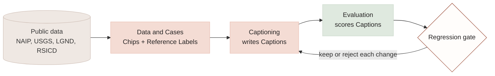
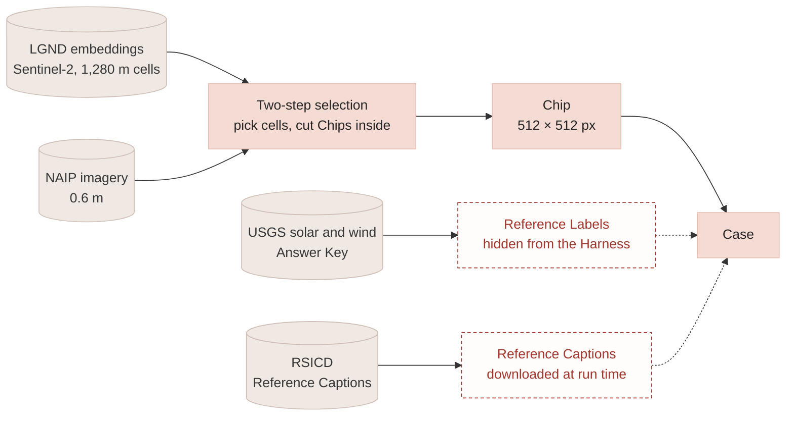
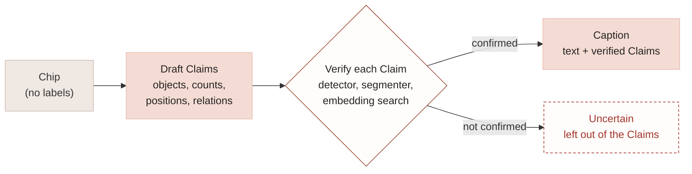
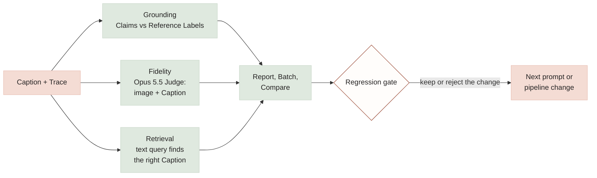
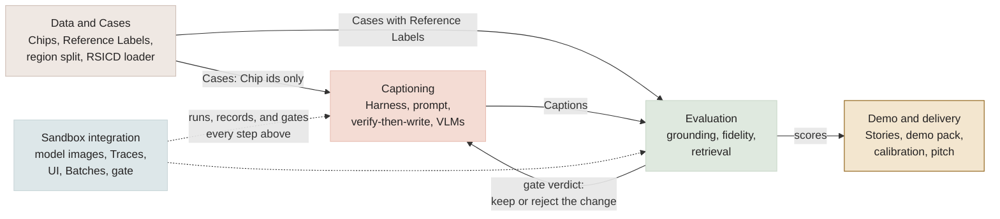
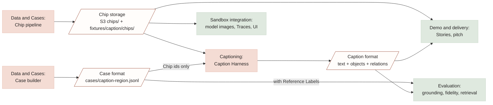

# Caption generation: hackathon plan

**For:** the whole team (six people).
**Status:** agreed plan, 2026-11-03. Owners are blank until Day 1.
**Read with:** [caption-design.md](caption-design.md) (the technical reference: requirements,
architecture, background), [GLOSSARY.md](../GLOSSARY.md) (every capitalized term here), and
ADRs [0006](adr/0006-answer-keys-are-hidden-from-caption-inputs.md) and
[0007](adr/0007-claims-use-a-grid-and-a-fixed-relation-vocabulary.md).
**Source requirements:** `tech-hackathon.docx` and `vision-hackathon.docx` at the repo root.

## 1. Goal

Build a caption-generation capability for the text-native Clay v2 model, and prove it with the
Sandbox's evaluation loop: a Harness writes Captions for Chips of aerial imagery, and every
Caption is scored on the criteria Clay set: **grounding** (most important), **fidelity**, and
**retrieval**, then **cost** and **label preparation time** if time allows. The differentiator is
not just a captioner but one shown to get measurably better, with the cost of each improvement
visible.

### 1.1 The big picture



Data and Cases turns public data into Cases; Captioning writes a Caption for each; Evaluation
scores it; the gate decides whether each change to the captioner is kept. The next three diagrams
zoom into each part.

### 1.2 Where the data goes



A Case pairs a Chip with what it is graded against. The red, dashed boxes are reference data:
they travel with the Case to scoring but never reach the Harness
([ADR-0006](adr/0006-answer-keys-are-hidden-from-caption-inputs.md)). RSICD is never committed
to the repo.

### 1.3 How the Harness writes a Caption



Verify, then write: the Harness (Nova Pro) commits only to Claims an independent tool confirms.
The verifying tools must never be an Answer Key, or grounding becomes circular. Claims use the
3×3 grid and relation vocabulary of
[ADR-0007](adr/0007-claims-use-a-grid-and-a-fixed-relation-vocabulary.md).

### 1.4 How a Caption is scored



Each criterion is reported on its own until Clay sets weights. Grounding uses the Case's Reference
Labels; fidelity and retrieval can also use RSICD's Reference Captions. Cost and label
preparation time join later (Should and Could).

## 2. Scope

| | Includes | Rubric criteria it serves |
|---|---|---|
| **Must** | Fixed Cases from USGS solar and wind sites, with NAIP Chips; ~60 Cases per region; Nova Pro captions, Opus 5.5 judges; grounding, fidelity, retrieval; ~100 RSICD test images as a human-caption benchmark for fidelity and retrieval; reports, Batches, gate, demo Stories | Grounding, Fidelity, Retrieval |
| **Should** | VLM comparison on GPU cost (2+ open VLMs on a GPU instance); Change Cases from USGS installation years; full RSICD test split (1,093 images) | Cost, Grounding (change) |
| **Could** | Agentic captioning through the LGND Geo MCP server; label preparation time; Global Renewables Watch as an Answer Key outside the US; disaster Change Cases from Vantor (used under its own license, never committed) | Label prep time, Grounding |
| **Out** | Training Clay v2; HyperPod or large Trainium clusters; a single combined caption score (rubric weights aren't set) | — |

Report each criterion separately until Clay sets weights.

## 3. Data

Access verified from a laptop on 2026-11-03 (small test reads only).

| Source | Role | Access | License |
|---|---|---|---|
| USGS USPVDB v4.0 (solar) | Answer Key: 6,611 sites with centroids, polygons, area, capacity, installation year | Download from `energy.usgs.gov/uspvdb/data/` (the `eerscmap.usgs.gov` address in the brief can be blocked on some networks) | Public domain |
| USGS USWTDB v9.1 (wind) | Answer Key: 77,839 turbines with exact positions and installation years | `energy.usgs.gov/uswtdb/` (CSV 1.7 MB) | Public domain |
| NAIP on Planetary Computer | Chips during preparation: same imagery, free; 0.6 m, 2010–2023 | STAC search + short-lived SAS token, windowed COG reads | Public domain (USDA FSA) |
| NAIP on AWS (`naip-visualization`, `naip-analytic`) | Chips in the sandbox | Requester-Pays, us-west-2; needs sandbox credentials | Public domain |
| LGND embeddings (Source Cooperative) | Choosing what to caption (step 1 of two-step selection) | Anonymous; GeoParquet by geohash/month; query rows with DuckDB, don't download whole files (~340 MB each) | CC BY 4.0 |
| RSICD (`201528014227051/RSICD_optimal` on GitHub; images from `arampacha/rsicd` on Hugging Face) | Reference Captions for fidelity and retrieval only | Captions and splits from GitHub; images from Hugging Face (same 8,734 / 1,094 / 1,093 split) | **None stated; imagery from commercial map services** |
| Global Renewables Watch v1.0 | Could: Answer Key outside the US | GitHub release (wind 58 MB, solar 395 MB) | MIT |
| Vantor open data | Could: disaster Change Cases | Anonymous S3 listing; 12 disaster events from 2026, ~15 GB per scene | CC BY-NC 4.0 |

**Regions.** Develop and tune in **California's Mojave / Tehachapi area**; test once, at the end,
in **Texas**. Tuning never touches the Texas Cases.

**Cases per region.** About 40 positives (solar arrays and wind turbines, mixed sizes) and 20
negatives (farmland, towns, empty desert, and look-alikes such as greenhouses and parking lots).

**Chips.** 512 × 512 px at 0.6 m (about 300 m across), RGB.

**Two-step selection.** LGND embeddings are Sentinel-2 based (10 m pixels, 1,280 m cells), coarser
than a Chip. Use them to pick diverse or interesting cells, then cut NAIP Chips inside those cells.

**Storage.** Shared working copy in an **S3 bucket in the sandbox account**. About **50
development Chips are committed to the repo** for the demo pack and tests (NAIP is public domain).

**RSICD rules.**
- Download at run time; **never commit RSICD images or Reference Captions** to the repo.
- Demo Stories store only our Captions, scores, and RSICD image ids.
- Cite Lu et al. 2017, *Exploring Models and Data for Remote Sensing Image Caption Generation*,
  IEEE TGRS 56(4).
- Two-thirds of RSICD's captions are repeats; de-duplicate per image before using them as
  retrieval queries.
- Its captions rarely state counts or positions, so don't use them as a style to imitate.

**Answer Keys are hidden from caption inputs** ([ADR-0006](adr/0006-answer-keys-are-hidden-from-caption-inputs.md)).
No tool the caption Harness can call may read USGS, GRW, or OSM data for the region being scored.

## 4. Functional areas

The work is organized by function. Each area has one owner who makes sure it lands; anyone can
work in any area, and one person can own more than one.



Solid arrows are hand-offs between areas; their formats are the contracts in section 5. Sandbox
integration (dashed) is the platform the other areas run on.

| Area | Covers | Owner |
|---|---|---|
| **Data and Cases** | Chips from NAIP; Reference Labels from USGS; two-step selection with LGND embeddings; the region split; pre-staging Chips in S3; the RSICD loader | ________ |
| **Captioning** | The caption Harness and prompt; structured Caption output; verify-then-write; the VLMs (Nova Pro, Opus 5.5, open VLMs later) | ________ |
| **Evaluation** | Grounding, the image-aware Judge for fidelity, retrieval; later cost and label preparation time | ________ |
| **Sandbox integration** | Images in the model interface; Trace fields (including GPU time); UI views; Batches, Compare, and the gate for the caption Task | ________ |
| **Demo and delivery** | Caption Stories and the demo pack; calibration labels; the pitch; readiness | ________ |

## 5. Contracts between the functions



These are **drafts** to ratify on Day 1. Once agreed, each functional area can build against them
without waiting for the others.

### 5.1 Case format

One JSON object per line in `cases/caption-<region>.jsonl`:

```json
{
  "id": "fixed-dev-uspvdb-58123",
  "task": "caption",
  "kind": "fixed",
  "region": "dev",
  "chips": [
    {"id": "ca-uspvdb-58123-20220618", "uri": "s3://<bucket>/chips/ca-uspvdb-58123-20220618.png",
     "date": "2022-06-18", "bbox": [-118.033, 35.184, -118.027, 35.190], "source": "naip-pc"}
  ],
  "reference_labels": [
    {"object": "solar_array", "count": 1, "position": "centre", "source": "uspvdb", "source_id": "58123"}
  ]
}
```

- `kind` is `fixed` (one Chip) or `change` (a Chip Pair, two entries in `chips`).
- `reference_labels` is **never shown to the Harness** (ADR-0006); only scoring reads it.
- RSICD Cases use `"source": "rsicd"`, an RSICD image id instead of a `uri`, and
  `reference_captions` loaded at run time instead of being stored.
- Negative Cases have an empty `reference_labels` list.

### 5.2 Caption format

What the Harness returns for each Case:

```json
{
  "case_id": "fixed-dev-uspvdb-58123",
  "text": "A large solar array fills the centre of the image, with a paved road running along its north side and open desert to the south.",
  "objects": [
    {"id": "o1", "object": "solar_array", "count": 1, "position": "centre"},
    {"id": "o2", "object": "road", "count": 1, "position": "north"}
  ],
  "relations": [
    {"subject": "o2", "relation": "north_of", "object": "o1"}
  ],
  "uncertain": ["whether the structure in the south-east is a substation"]
}
```

- **Positions** ([ADR-0007](adr/0007-claims-use-a-grid-and-a-fixed-relation-vocabulary.md)):
  `north_west`, `north`, `north_east`, `west`, `centre`, `east`, `south_west`, `south`,
  `south_east`.
- **Relations:** `north_of`, `south_of`, `east_of`, `west_of`, `adjacent_to`, `between`, `inside`.
- **Objects (draft, extend on Day 1):** `solar_array`, `wind_turbine`, `road`, `building`,
  `water`, `field`, `parking_lot`, `greenhouse`, `vegetation`, `bare_ground`.
- `uncertain` holds what the Harness chose not to assert; it isn't scored as a Claim.
- For Change Cases, objects gain a `change` field: `appeared`, `disappeared`, or `unchanged`.

### 5.3 Chip storage

- S3 layout: `s3://<bucket>/chips/<chip-id>.png` plus `chips/<chip-id>.json` (date, bbox, source,
  NAIP item id).
- Chip id: `<state>-<answer-key>-<source-id>-<yyyymmdd>`, or `<state>-neg-<n>-<yyyymmdd>` for
  negatives.
- The committed subset lives in `fixtures/caption/chips/` with the same names.

## 6. Approach

1. **Verify, then write.** The Harness first produces candidate Claims, checks each with an
   independent source (a detector, segmenter, or embedding search; never an Answer Key), and
   writes the final Caption only from Claims that passed, putting the rest in `uncertain`.
2. **Embeddings choose what to caption.** Two-step selection (section 3) picks diverse,
   informative Chips instead of thousands of near-identical fields.
3. **Improve with the Sandbox loop.** Each prompt or pipeline change is a new Batch; Compare
   shows the per-criterion effect; the regression gate decides whether to keep it.
4. **Teacher → student on the cost frontier** (Should, needs a GPU). A large VLM captions a seed
   set; a small open VLM is prompted or fine-tuned to match; plot quality against GPU-seconds per
   Caption.

**Models.** Amazon Nova Pro writes Captions; Claude Opus 5.5 judges fidelity (an independent
Judge, since it didn't write them). Opus 5.5 also captions as the first comparison VLM; those
verdicts are flagged as self-graded.

## 7. Timeline


### Before kickoff (work that doesn't need the sandbox)

- [x] Verify data access (done 2026-11-03; section 3).
- [x] Draft the three contracts (section 5).
- [ ] Rewrite the caption requirements in `docs/spec.md` (REQ-C1, REQ-C2) and the caption section
  of `docs/questions-for-clay.md` from the new source documents.
- [ ] Send the questions to Clay (section 9).
- [ ] Optional head start: build development Cases and Chips from USGS + NAIP on Planetary
  Computer.

### Day 1: planning, ending with a working skeleton

- [ ] An owner for each functional area (section 4).
- [ ] The three contracts reviewed and ratified, including the object vocabulary.
- [ ] Data access confirmed **inside the sandbox account**: NAIP on AWS with request-payer, the
  shared S3 bucket, USGS downloads, LGND embeddings.
- [ ] **Walking skeleton:** one Chip goes all the way from Chip → Caption → scores → report,
  even with crude parts.

### Day 2: build

**Morning (Must):**

| Area | Morning deliverable |
|---|---|
| Data and Cases | ~60 development Cases and Chips, pre-staged in S3; ~100 RSICD test images loaded at run time |
| Captioning | Caption prompt and structured output on Nova Pro; verify-then-write, first version |
| Evaluation | Grounding (per-Claim comparison with Reference Labels); image-aware Judge for fidelity; retrieval (text embeddings, recall@k; queries from Answer Key classes and de-duplicated RSICD Reference Captions) |
| Sandbox integration | Images in the model interface; Trace and UI support for the caption Task |
| Demo and delivery | Story outline; the midday freeze checklist |

**Midday freeze.** A scored Batch of development Fixed Cases, plus the RSICD benchmark, is
recorded into the demo pack. From here on, the demo works even if everything later breaks.

**Afternoon:**
- Improvement loop: Batches, Compare, gate on prompt or pipeline changes.
- Opus 5.5 as a second captioning VLM; score the Texas test region **once**.
- Should items as time allows: GPU-cost comparison, Change Cases, full RSICD test split.
- Demo Stories and the pitch.

## 8. Risks

| Risk | Mitigation |
|---|---|
| Grounding becomes circular (the Harness sees the Answer Key) | ADR-0006; the region split; the Evaluation owner reviews the Harness's tool list before each Batch |
| GPU cost needs a GPU instance (AWS work not yet done) | Cost is a Should; Must uses Bedrock VLMs and marks cost as partial |
| NAIP Requester-Pays cost | Planetary Computer for preparation; pre-stage Chips once in S3 and reuse |
| RSICD has no license | Run-time download only; never committed; cite; confirm with Clay |
| Rubric weights unset | Report criteria separately; no combined score |
| The Judge is lenient or self-graded | Opus 5.5 judges Nova Pro's Captions; self-graded verdicts are flagged; calibration labels on the Calibrate tab |
| Integration breaks late | Day 1 walking skeleton; Day 2 midday freeze |

## 9. Questions for Clay

- What does **label preparation time** measure: preparing Reference Labels, or producing
  Captions (which are training labels for Clay v2)?
- Format and location of the **example captions**; fixed, change, or both?
- Which regions have **LGND collections**, and how do teams access the LGND Geo MCP server?
- Which **VLMs** should be compared, and what GPU instance and budget are acceptable?
- Are there **Vantor vectors** beyond the open bucket, which holds disaster imagery?
- Is using **RSICD** (no license; commercial-map imagery) acceptable as a benchmark?
- When will the **rubric weights** be set?

## 10. Decisions behind this plan

Agreed in a planning session on 2026-11-03. The reasoning for the two hardest-to-reverse
decisions is in ADR-0006 and ADR-0007.

| Decision | Choice |
|---|---|
| Plan audience and form | This document, for all six teammates, safe for the public repo |
| Time boxes | Before kickoff; Day 1 planning plus walking skeleton; Day 2 build with a midday freeze |
| Must scope | Fixed Cases on USGS solar and wind; grounding, fidelity, retrieval; one Bedrock VLM |
| Regions | Develop in Mojave/Tehachapi; test once in Texas |
| NAIP source | Planetary Computer for preparation; AWS in the sandbox |
| Embedding selection | Two steps: LGND cells first, NAIP Chips inside them |
| Vantor | Out of Must; possible disaster Change Cases; never committed |
| Organization | Five functional areas, one owner each (section 4); no fixed team split |
| Claim format | 3×3 position grid and a fixed relation vocabulary (ADR-0007) |
| Chip storage | Sandbox S3 bucket; ~50 Chips committed |
| Models | Nova Pro captions; Opus 5.5 judges; Opus 5.5 also captions as a comparison |
| Chip size and Case counts | 512 × 512 px at 0.6 m; ~40 positive and ~20 negative Cases per region |
| Approach | Verify then write; embedding selection; improvement loop; teacher → student if a GPU |
| RSICD | Fidelity and retrieval benchmark only; ~100 test images Must, full split Should; never committed |
| Vocabulary | Chip, Chip Pair, Fixed Case, Change Case, Caption, Claim, Reference Label, Answer Key, Reference Caption |
